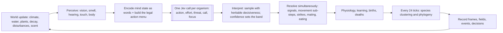

# Lifeform — Master Plan

> **A 2D artificial ecology in which every animal's every action comes from one Jev call per tick. Evolution acts on the bodies, senses and temperaments those calls read.**

- **Date:** 2026-09-26
- **Status:** plan complete, pre-implementation
- **Scope:** Python simulator (Jev SDK), recorded run bundles, and a web replay theater

---

## 1. What we are building

- A **Python backend** simulates discrete-time ecologies across **12 world settings** (plus 2 stretch worlds). Each tick, **every living animal makes exactly one Jev `system_one` call**. The answer decides its action, effort, danger appraisal, vocal call and focus of attention.
- **Everything else is mathematics, in code:** climate, water, plant growth, scent diffusion, metabolism (Kleiber), thermoregulation (Scholander), digestion (Holling), growth (West), aging (Gompertz–Makeham), disease (SEIR with evolving strains), learning (Rescorla–Wagner), dominance (Elo), genetics (diploid, linked, mutating), and speciation (genetic clustering).
- **Evolution** acts on heritable morphology, physiology, senses, life history, **temperament and instincts**. The last two are expressed as words in each animal's state, so natural selection shapes what Jev reads and therefore how animals behave.
- Every run is **recorded** into a chunked bundle. A **web theater** (Vite + TypeScript + PixiJS 8 + Svelte 5 + D3) replays it with painterly terrain, day–night light, weather, procedural creatures, event effects, charts, a cinematic auto-camera, and a **Mind Inspector** that shows exactly what each animal sensed and what Jev answered.

---

## 2. The one law: "Code computes, Jev chooses"

| Code (deterministic models, seeded randomness) | Jev (one call per organism per tick) |
| --- | --- |
| World physics, climate, plants, water, chemistry, sound | Which action to take from a menu of legal, grounded options |
| Perception (who can see, smell or hear what, how certainly) | How much effort the situation deserves (urgency) |
| Turning numbers into words; relational facts ("faster than you") | How dangerous this moment is (drives fear) |
| Which options are *legal* (affordances) | Which call to make, if any |
| Physiology, combat, reproduction and disease outcomes | What matters most right now (attention, and therefore learning) |
| Genetics, development and speciation | — |
| **Never chooses an action** (rule J12) | **Never computes** (no counting, arithmetic or coordinates) |

---

## 3. The tick

---

## 4. Key decisions

| Decision | Choice | Why |
| --- | --- | --- |
| Decision source | Jev `jev-1.13.0` (pinned), exactly 1 call per organism per tick, 5 questions per call | The user's requirement. Jev evaluates questions in parallel within one call, so extra questions add almost no latency |
| No LLM layer | Removed. Confidence modulates execution (decisive, hesitant, dithering) instead of escalating | The user wants all dynamics from Jev. Calibrated confidence gets a biological role |
| State format | Words only, 600–900 tokens, salience-ranked | Jev can't count or do arithmetic, and irrelevant context lowers its accuracy ([01 §1.5](docs/plan/01-jev-research.md)) |
| Action space | 55 primitive verbs + 8 calls, offered as ≤ 32 legal affordances per call | Grounded choices; illegal options are impossible by construction |
| Behavioral evolution | 9 temperament genes and 24 instinct genes rendered as text in the state, plus 2 decision-style genes applied when interpreting answers | Heritable behavior without code reflexes; verified by the Question Lab |
| Plants | Fields (7 food layers), not agents | Only animals are decision-makers; Jev throughput is reserved for them |
| Space | Torus, 96²–224² per world (default 160²) | Encounter density at an affordable population of about 100 |
| Time | Tick = 2 h, day = 12 ticks, compressed 576-tick year | 5–10 generations per standard run for fast breeders |
| Failure policy | Retry, then pause at a checkpoint. Never a code-chosen action | The simulation is turn-based, so there is no staleness; integrity over speed |
| Replay | Msgpack + gzip chunked bundles; the browser decodes natively | No Jev calls on replay; bit-faithful playback |
| Backend stack | Python 3.12+, numpy 2.5, pydantic 2.13, typesafe-sdk 0.7.x, FastAPI, Typer | Matches the Jev SDK and the user's existing `immune` conventions |
| Frontend stack | Vite 8, TypeScript 7, PixiJS 8.21, Svelte 5, D3 7.9 | WebGL/WebGPU 2D performance, custom shaders, class-based engine |
| Code style | OOP, hexagonal layering, no inline comments, no magic numbers, typed parameter objects | The user's direction ([02 §2.10](docs/plan/02-architecture.md)) |

---

## 5. How this plan departs from the reference document

The reference document was used as inspiration, as instructed, not implemented as written.

| Reference idea | Lifeform |
| --- | --- |
| Jev reflexes + LLM escalation at low confidence | **Jev only.** Low confidence produces hesitation or dithering, with an urgency override |
| Code reflex table and weighted votes with inhibition | Jev's probability distribution over affordances. "Inhibition" emerges because feelings and threats in the state shift Jev's choice |
| $Q(a)$ utility equation; confidence as the margin between the top two options | Jev's calibrated `confidence` and full `probabilities`. The margin $p_1 - p_2$ is logged for analysis |
| Experiences compiled into reflexes by an LLM | Rescorla–Wagner associations, memories and recognition that **Jev reads**. Confidence rises with experience |
| Fixed 7×7 window | Trait-driven senses: vision 3–12 patches, smell through diffused fields, hearing through dB propagation |
| Linear temperature gradient $T_0 + \Delta T\,x/W$ | A periodic latitude profile. The linear one would create a 30 °C cliff at the torus seam |
| 6 terrain types | 13 terrain types + 7 food layers + canopy, snow, nutrients, toxins and pathogens |
| `DIE` as an action | Death is never chosen; there are 13 modeled causes of death |
| `PICKUP`/`DROP` | `carry_food`, `cache_food`, `drop_food`, `share_food`, `steal_food` |
| 256×256 for everything | Per-world sizes (default 160²), set by encounter density versus Jev budget |
| Reproduction as an action | Courtship **and** consent: both animals choose through Jev, then conception, gestation, birth, nursing and weaning |

---

## 6. By the numbers

| Item | Count |
| --- | --- |
| World settings | 12 core + 2 stretch |
| Terrain types / food layers / scent channels | 13 / 7 / 7 fixed + up to 16 species musks |
| Genome loci (diploid) | 89 = 57 trait + 24 instinct + 8 neutral markers |
| Founder archetypes | 10 |
| Body verbs / calls | 55 / 8 |
| Jev questions per call | 5 (1 action Choice, 2 Scores, 2 Choices) |
| Menu size per call | ≤ 32 options |
| Tick pipeline phases | 19 |
| Causes of death | 13 |
| Standard full run | about 1.6M Jev calls, about 22 h at 1,200 RPM, about $87 |
| Preview run (all worlds) | about 180k calls, about 2.5 h, about $10 |

---

## 7. Document map

| # | Document | Contents |
| --- | --- | --- |
| 01 | [Jev research](docs/plan/01-jev-research.md) | What Jev is, the verified SDK API, limits, pricing, confidence, weaknesses, prior art, design rules J1–J12, cost model, sources |
| 02 | [Architecture](docs/plan/02-architecture.md) | Layers, repository layout, tick pipeline, concurrency, determinism, configuration, interfaces, design patterns, **code standards**, tooling, CLI, resilience |
| 03 | [World model](docs/plan/03-world-model.md) | Space, time, terrain, fields, generation, climate, light, hydrology, producers, nutrients, scent, sound, disturbances |
| 04 | [Organism model](docs/plan/04-organism-model.md) | Identity, the full **genome** (89 loci), instincts, temperament words, allometric development, body state, drives, conditions, **senses**, memory and learning, social attributes, trade-offs, archetypes |
| 05 | [Ecology rules](docs/plan/05-ecology-rules.md) | Energy, thermoregulation, water, **feeding**, growth, health, sleep, **predation and combat**, **reproduction**, genetics, speciation, **disease**, social rules, **death**, calibration, expected phenomena |
| 06 | [Action catalog](docs/plan/06-action-catalog.md) | 55 verbs with legality, execution, cost and visuals; 8 calls; effort levels; affordance generation; resolution order; confidence bands |
| 07 | [Jev nervous system](docs/plan/07-jev-nervous-system.md) | The call contract, the full mind-state example, vocabulary, salience, **exact question wording**, answer interpretation, genome-to-behavior paths, the Brain port, the decision tape, the **Question Lab** |
| 08 | [World settings](docs/plan/08-world-settings.md) | All 14 worlds: concept, map, climate, rules, founders, hypotheses, look; the preset file shape |
| 09 | [Replay and visualization](docs/plan/09-replay-and-visualization.md) | Bundle format, recorder, server, frontend classes, shaders, creature design, effects, UI and UX, Mind Inspector, Cinematic Director, aesthetic direction, performance, exports |
| 10 | [Analysis, testing, roadmap](docs/plan/10-analysis-testing-roadmap.md) | Population, evolution and behavior analytics, the Chronicle, the test pyramid, milestones M0–M9, risks, open questions, glossary |

---

## 8. Roadmap at a glance

**M0** foundations and Jev probe (key gate: temperament sensitivity) → **M1** world substrate → **M2** organism core → **M3** perception and mind → **M4** actions and ecology (first real 60-tick run) → **M5** recording and theater MVP → **M6** evolution and analysis → **M7** calibration of all worlds and a preview run → **M8** aesthetic polish → **M9** the big run and findings report. The plan is about 14 weeks; details and exit criteria are in [10 §10.4](docs/plan/10-analysis-testing-roadmap.md).

---

## 9. Before implementation starts

Six open questions need the user's answer. They are listed in [10 §10.6](docs/plan/10-analysis-testing-roadmap.md): API tier, budget, world priorities, code-style reading, hosting and sound.
