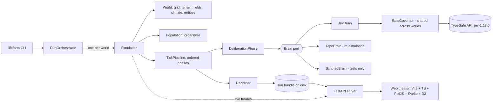

# 02 — System Architecture and Code Standards

---

## 2.1 Overview



- **Backend (Python):** simulates worlds in discrete time and makes exactly one Jev call per living organism per tick. It records everything into a *run bundle*.
- **Frontend (TypeScript):** a replay theater that plays bundles back with interpolation, cinematic effects, charts and a "mind inspector". It never calls Jev.
- **Server (FastAPI):** serves bundles and optionally streams live frames from a running simulation.

---

## 2.2 Layering (hexagonal)

| Layer | Package(s) | Depends on | Must not depend on |
| --- | --- | --- | --- |
| **Domain** | `world`, `biology`, `perception`, `actions`, `ecology`, `evolution` | `core`, numpy | SDKs, I/O, web, asyncio |
| **Cognition** (domain port plus encoding) | `cognition` (vocabulary, affordances, state encoder, question panel, decision interpretation, `Brain` protocol) | domain, `core` | TypeSafe SDK (only the adapter touches it) |
| **Application** | `simulation` (engine, phases, orchestrator, checkpoints) | domain, cognition | concrete adapters (injected) |
| **Adapters** | `adapters/jev` (SDK), `adapters/tape`, `recording` (bundle I/O), `config/loaders` | application ports | — |
| **Interfaces** | `cli`, `server` | application, adapters | — |

The TypeSafe SDK is imported in **one** package only: `lifeform.adapters.jev`. An SDK upgrade touches only that package.

---

## 2.3 Repository layout

```text
lifeform/
├── PLAN.md
├── README.md
├── pyproject.toml
├── uv.lock
├── docs/plan/                          # this plan
├── presets/                            # world settings (YAML), one file per world
│   ├── serengeti-pulse.yaml
│   ├── galapagos-scatter.yaml
│   └── ...
├── archetypes/                         # founder species genome presets (YAML)
├── lab/                                # Question Lab scenario fixtures (YAML)
├── runs/                               # run bundles (git-ignored)
├── src/lifeform/
│   ├── core/
│   │   ├── geometry.py                 # Position, Direction, TorusMetric
│   │   ├── time.py                     # Tick, Calendar, TimeOfDay, Season
│   │   ├── randomness.py               # RandomStreams (SeedSequence spawning)
│   │   ├── identifiers.py              # OrganismId, SpeciesId, CarcassId
│   │   ├── units.py                    # Energy, Mass, Temperature value objects
│   │   └── events.py                   # DomainEvent types, EventBus
│   ├── config/
│   │   ├── run_config.py               # RunConfig, BudgetConfig, BrainConfig
│   │   ├── world_preset.py             # WorldPreset and nested parameter models
│   │   ├── parameters.py               # EcologyParameters, PhysiologyParameters, ...
│   │   └── loaders.py                  # YAML -> pydantic, config hashing
│   ├── world/
│   │   ├── grid.py                     # ToroidalGrid, Neighborhood
│   │   ├── terrain.py                  # TerrainType, TerrainProperties, TerrainMap
│   │   ├── fields/
│   │   │   ├── scalar_field.py         # ScalarField base (float32 ndarray)
│   │   │   ├── vegetation.py           # FoodLayer, VegetationField
│   │   │   ├── hydrology.py            # SurfaceWater, SoilMoisture, Snowpack
│   │   │   ├── temperature.py          # TemperatureField
│   │   │   ├── light.py                # LightField
│   │   │   ├── nutrients.py            # SoilNutrientField
│   │   │   ├── chemical.py             # ScentChannel, ChemicalLandscape
│   │   │   ├── toxin.py                # ToxinField
│   │   │   ├── pathogen.py             # EnvironmentalPathogenField
│   │   │   └── fire.py                 # FireField
│   │   ├── climate.py                  # Climate, WeatherState, WeatherMarkovChain, ClimateDrift
│   │   ├── acoustics.py                # SoundEvent, SoundBoard
│   │   ├── entities.py                 # Carcass, Den, FoodCache, EntityIndex (spatial hash)
│   │   ├── disturbances/               # Wildfire, FloodPulse, Drought, Eruption, Rift, Glaciation
│   │   ├── generation/                 # NoiseField, ElevationBuilder, RiverCarver, BiomeClassifier, WorldBuilder
│   │   └── world.py                    # World aggregate root, WorldSnapshot (read-only view)
│   ├── biology/
│   │   ├── genome.py                   # GeneSpec, GeneCatalog, Genome
│   │   ├── instincts.py                # Instinct, InstinctCatalog
│   │   ├── inheritance.py              # Recombination, Mutation, GeneticDistance
│   │   ├── allometry.py                # pure scaling functions (Kleiber etc.)
│   │   ├── phenotype.py                # Phenotype, Development
│   │   ├── physiology/
│   │   │   ├── metabolism.py           # MetabolicModel
│   │   │   ├── thermoregulation.py     # EndothermModel, EctothermModel, ThermalBlend
│   │   │   ├── water_balance.py        # WaterBalanceModel
│   │   │   ├── digestion.py            # Stomach, DigestionModel, DietProfile
│   │   │   ├── growth.py               # OntogeneticGrowthModel
│   │   │   ├── healing.py              # HealingModel
│   │   │   ├── sleep.py                # TwoProcessSleepModel
│   │   │   └── aging.py                # GompertzMakehamHazard
│   │   ├── drives.py                   # DriveState, DriveCalculator
│   │   ├── conditions.py               # Condition enum, ConditionSet
│   │   ├── disease.py                  # Pathogen, Strain, Infection, ImmuneState
│   │   ├── reproduction.py             # ReproductiveState, Pregnancy, Litter
│   │   ├── social.py                   # SocialState, DominanceRating, Bond
│   │   ├── lineage.py                  # Lineage, Pedigree, Relatedness
│   │   ├── naming.py                   # IndividualNamer, SpeciesNamer
│   │   └── organism.py                 # Organism aggregate
│   ├── perception/
│   │   ├── percepts.py                 # EntityPercept, ScentPercept, SoundPercept, BodyPercept
│   │   ├── senses/                     # VisionSense, OlfactionSense, HearingSense, TouchSense, Interoception
│   │   ├── line_of_sight.py            # BresenhamRay, Occlusion
│   │   ├── perceptual_field.py         # PerceptualField (everything sensed this tick)
│   │   ├── salience.py                 # SalienceRanker
│   │   └── memory/                     # SpatialMemory, SocialMemory, EpisodicMemory, AssociativeLearner
│   ├── cognition/
│   │   ├── vocabulary.py               # Quantizer, Lexicon (numbers -> words)
│   │   ├── relations.py                # RelationalFacts (bigger/faster/noticed-you/blocked)
│   │   ├── affordances.py              # Affordance, AffordanceGenerator, AffordanceMenu
│   │   ├── mind_state.py               # MindState, MindStateEncoder
│   │   ├── question_panel.py           # QuestionPanel, QuestionSpec, PanelWording
│   │   ├── decision.py                 # RawDecision, Decision, Intent
│   │   ├── decision_policy.py          # DecisivenessSampler, HesitationRule
│   │   └── brain.py                    # Brain protocol, BrainUnavailable
│   ├── adapters/
│   │   ├── jev/
│   │   │   ├── gateway.py              # JevGateway (client lifecycle, retries, error mapping)
│   │   │   ├── rate_governor.py        # RateGovernor (token buckets + AIMD)
│   │   │   ├── codec.py                # QuestionPanel -> SDK questions; SDK answers -> RawDecision
│   │   │   └── jev_brain.py            # JevBrain
│   │   ├── tape/                       # DecisionTapeWriter, DecisionTapeReader, TapeBrain
│   │   └── scripted/                   # ScriptedBrain (tests), HeuristicBrain (dev-only)
│   ├── actions/
│   │   ├── verbs.py                    # Verb enum, VerbSpec, VerbCatalog
│   │   ├── signals.py                  # Call enum, CallSpec
│   │   ├── intents.py                  # Intent (Verb + target + effort + hesitation)
│   │   ├── resolvers/                  # one resolver per verb family (Strategy)
│   │   ├── movement.py                 # SubStepMover, InitiativeOrder, OccupancyLedger, LocalPlanner
│   │   └── outcomes.py                 # ActionOutcome, OutcomeLog
│   ├── ecology/
│   │   ├── predation.py                # AttackModel, PursuitModel, GroupDefense
│   │   ├── foraging.py                 # BiteModel, ResourceSharing
│   │   ├── contests.py                 # ContestModel, EloDominance
│   │   ├── mating.py                   # CourtshipModel, ConceptionModel
│   │   ├── epidemiology.py             # TransmissionModel, StrainEvolution
│   │   ├── mortality.py                # DeathCause, MortalityJudge
│   │   └── decomposition.py            # CarcassDecay, NutrientReturn
│   ├── evolution/
│   │   ├── speciation.py               # SpeciesClusterer, SpeciesRegistry
│   │   ├── phylogeny.py                # PhylogeneticTree
│   │   └── selection_metrics.py        # SelectionDifferential, PriceDecomposition
│   ├── simulation/
│   │   ├── engine.py                   # Simulation
│   │   ├── pipeline.py                 # TickPipeline, Phase protocol
│   │   ├── phases/                     # one module per phase (see 2.4)
│   │   ├── orchestrator.py             # RunOrchestrator (multi-world scheduling)
│   │   ├── budget.py                   # BudgetGuard, CostEstimator
│   │   └── checkpoint.py               # Checkpointer (msgpack snapshots + RNG state)
│   ├── recording/
│   │   ├── bundle.py                   # RunBundle layout, Manifest
│   │   ├── frame_encoder.py            # columnar per-tick organism frames
│   │   ├── field_encoder.py            # quantized field keyframes
│   │   ├── event_log.py
│   │   ├── stats_collector.py
│   │   └── recorder.py                 # Recorder (EventBus subscriber)
│   ├── analysis/                       # population, traits, phylogeny, chronicle
│   ├── server/                         # FastAPI app: runs, bundles, live websocket
│   └── cli/                            # Typer app: run, estimate, lab, serve, export, list-worlds
├── tests/
│   ├── unit/  ├── property/  ├── golden/  ├── contract/  ├── scenario/  └── performance/
└── web/
    ├── package.json  ├── vite.config.ts  ├── tsconfig.json
    └── src/
        ├── data/        # ReplayStore, ChunkFetcher, codecs
        ├── playback/    # PlaybackClock, Interpolator
        ├── render/      # WorldRenderer, layers, shaders, CreatureSpriteFactory, effects
        ├── camera/      # CameraController, TorusWrapper, CinematicDirector
        ├── charts/      # Streamgraph, PhylogenyTree, TraitRidgeline, PhasePortrait
        ├── ui/          # Svelte components (thin)
        └── main.ts
```

(The `#` annotations in this tree describe the layout. They are not code comments.)

---

## 2.4 The tick pipeline

Each tick is a **barrier**: every organism perceives the same read-only `WorldSnapshot`, every decision is collected, and then actions are resolved simultaneously. Phases are small classes that implement `Phase.run(context)` and are composed by `TickPipeline`. The order is fixed and recorded in the manifest.

| # | Phase | Reads | Writes | Notes |
| --- | --- | --- | --- | --- |
| 1 | `CalendarPhase` | tick | time of day, season, moon | |
| 2 | `ClimatePhase` | calendar, climate drift | weather state, temperature, precipitation, wind, clouds | Markov weather |
| 3 | `HydrologyPhase` | precipitation, temperature | surface water, soil moisture, snowpack, ice | |
| 4 | `ProductionPhase` | light, temperature, moisture, nutrients | food layers (grass, browse, fruit, seeds, invertebrates, algae, fungi) | logistic growth and dispersal |
| 5 | `DecompositionPhase` | carcasses, dung, temperature | carcass mass and spoilage, nutrients, carrion scent source | |
| 6 | `DisturbancePhase` | fuel, dryness, preset schedule | fire, flood, eruption, rift, glaciation | |
| 7 | `DiffusionPhase` | scent sources, wind | scent channels, toxin, environmental pathogen | explicit diffusion–decay–advection |
| 8 | `PerceptionPhase` | `WorldSnapshot`, organisms | `PerceptualField` per organism | parallel over organisms (CPU) |
| 9 | `DeliberationPhase` | perceptual fields, organism state, memory | `Decision` per organism | **one Jev call per organism**, async fan-out |
| 10 | `IntentPhase` | decisions, genome | `Intent` per organism | sampling, hesitation, effort mapping |
| 11 | `SignalPhase` | intents | `SoundBoard` (heard next tick), scent marks | |
| 12 | `MovementPhase` | intents | positions, headings, pursuit results | sub-step initiative mover |
| 13 | `InteractionPhase` | intents, adjacency after movement | attacks, defenses, courtship, mating, grooming, nursing, sharing, contests | |
| 14 | `ConsumptionPhase` | intents, resources | intake into stomachs, water intake, resource depletion | contested resources are split |
| 15 | `PhysiologyPhase` | everything above | energy, water, body temperature, digestion, growth, healing, sleep pressure, fear, disease progression, parasites | pure models |
| 16 | `LearningPhase` | outcomes, percepts, focus | memories, associative values, habituation | Rescorla–Wagner |
| 17 | `LifecyclePhase` | physiology, hazards | births, deaths, carcasses, maturity, weaning | `MortalityJudge` |
| 18 | `EvolutionPhase` | every *k* ticks | species clusters, speciation and extinction events, phylogeny | default *k* = 24 |
| 19 | `RecordingPhase` | everything | frames, events, stats, decision tape; checkpoint every *m* ticks | |

**Why signals are heard next tick:** sound needs time to propagate, and it keeps the barrier clean. Everyone decides on the same snapshot.

---

## 2.5 Concurrency model

- **Within a tick:** `DeliberationPhase` builds all `MindState`s on the CPU, then runs `asyncio.gather` over `brain.decide(mind, panel)` for every organism. A bounded semaphore (default 32) caps requests in flight.
- **Rate governor:** a single `RateGovernor` (token bucket for requests per minute plus token bucket for tokens per second) is shared by every world. It starts at 90% of the published limits (1,080 RPM, 225k tokens/s). On 429 it halves the rate; after each clean minute it adds 5% back (AIMD).
- **Across worlds:** `RunOrchestrator` runs worlds as concurrent asyncio tasks. Each world advances tick by tick, and the governor interleaves their calls fairly (round-robin queue per world). While one world resolves its tick on the CPU, others use the network.
- **CPU work** (perception and resolution) runs on the event-loop thread in vectorized numpy. At ≤ 300 organisms per world it takes well under 50 ms per tick, so a process pool isn't needed. If profiling says otherwise, `PerceptionPhase` can move to a `ProcessPoolExecutor` per world.

---

## 2.6 Determinism and reproducibility

| Concern | Mechanism |
| --- | --- |
| Randomness | `RandomStreams` spawns independent `numpy.random.Generator`s from one `SeedSequence`, one per subsystem (climate, generation, perception noise, combat, mutation, decision sampling, and so on). Stream states are saved in checkpoints |
| Jev is not bit-reproducible across calls | The **decision tape** records the exact answers. `TapeBrain` re-simulates a run bit for bit from the tape |
| Order effects within a tick | Everyone perceives the same `WorldSnapshot`. Resolution order uses a seeded initiative order (see [06 §6.7](06-action-catalog.md)) |
| Option-order bias in Choices | Affordance order is shuffled per call by the decision-sampling stream, and the order is recorded |
| Config drift | `RunConfig` and `WorldPreset` are hashed (canonical JSON + SHA-256), and the hash is written to the manifest |
| Model drift | `response.model` is logged per decision. A run refuses to resume from a checkpoint under a different pinned model unless `--allow-model-change` is passed |

---

## 2.7 Configuration

- Configuration is built from **pydantic v2** models with frozen fields. Every coefficient has a descriptive name that includes its unit, for example `bite_rate_kg_per_tick_per_kg075`, `scent_half_life_ticks`, `lapse_rate_c_per_km`.
- **World presets** are YAML files in `presets/`. Each overrides defaults from `EcologyParameters`, `PhysiologyParameters`, `ClimateParameters` and others, and lists founder populations by archetype.
- **Archetypes** are YAML genome presets in `archetypes/`.
- **Runs** are configured with `RunConfig`: preset list, ticks, seed, brain, budget, recording detail and profile.
- Parameters are **never** hard-coded in logic. A domain class receives its parameter object through its constructor.

---

## 2.8 Key interfaces (illustrative skeletons)

```python
class Brain(Protocol):
    async def decide(self, mind: MindState, panel: QuestionPanel) -> RawDecision: ...
    async def close(self) -> None: ...


class Phase(Protocol):
    name: str
    def run(self, context: TickContext) -> None: ...


class AsyncPhase(Protocol):
    name: str
    async def run(self, context: TickContext) -> None: ...


@dataclass(frozen=True, slots=True)
class RawDecision:
    organism_id: OrganismId
    action_probabilities: Mapping[str, float]
    action_confidence: float
    effort_probabilities: Mapping[int, float]
    threat_probabilities: Mapping[int, float]
    call_probabilities: Mapping[str, float]
    focus_probabilities: Mapping[str, float]
    model_version: str
    input_tokens: int
    latency_ms: float
    status: DecisionStatus


class Simulation:
    def __init__(self, world: World, population: Population, pipeline: TickPipeline, recorder: Recorder) -> None: ...
    async def advance(self) -> TickReport: ...
    async def run_until(self, stop: StopCondition) -> RunReport: ...


class Organism:
    identity: OrganismIdentity
    genome: Genome
    phenotype: Phenotype
    body: BodyState
    drives: DriveState
    conditions: ConditionSet
    memory: MemorySystem
    social: SocialState
    reproduction: ReproductiveState
    infection: InfectionState
    lineage: Lineage
```

---

## 2.9 Design patterns and where they live

| Pattern | Where | Why |
| --- | --- | --- |
| **Ports and adapters** | `Brain` protocol with `JevBrain`, `TapeBrain`, `ScriptedBrain` | Swap the decision source without touching the domain; exact re-simulation |
| **Pipeline / chain of phases** | `TickPipeline` | Explicit, testable tick order |
| **Strategy** | one `ActionResolver` per verb family; `ThermalModel` (endotherm, ectotherm, blend) | Add verbs and models without editing a central switch |
| **Registry** | `VerbCatalog`, `GeneCatalog`, `InstinctCatalog`, `TerrainCatalog`, `CallCatalog` | Data-driven catalogs with a single source of truth |
| **Builder** | `WorldBuilder` from a `WorldPreset` | Complex, staged world generation |
| **Factory** | `OrganismFactory` (founders from archetypes, offspring from parents) | Keeps construction rules in one place |
| **Observer / event bus** | `EventBus` with the `Recorder`, `StatsCollector` and `Chronicle` as subscribers | Domain code never knows about recording |
| **Value objects** | `Position`, `Direction`, `Energy`, `Percept`, `Intent`, `Affordance` (frozen, slotted dataclasses) | Immutability, safe to share across phases |
| **Snapshot** | `WorldSnapshot` (read-only view) | Fair, simultaneous perception |
| **Memento** | `Checkpointer` | Resume long runs |
| **Template method** | `Sense.perceive()` → `detect()` / `describe()` | Shared sensing flow, specialized senses |
| **Specification** | `AffordanceRule`s (each decides "is this option legal and relevant?") | Composable legality |

---

## 2.10 Code standards

The user's direction is **object-oriented code that speaks for itself**. Concretely:

**Python**

1. **No inline comments.** Intent is carried by names, types and small methods. If a line needs a comment, extract a well-named method or constant instead. Public classes and protocols may have a one-line docstring when the name alone cannot state the contract.
2. **No magic numbers in logic.** Every coefficient lives in a typed parameter object whose field name includes its unit.
3. **Small units.** Target ≤ 20 lines per method and one responsibility per class. A module is named after the concept it holds.
4. **Composition over inheritance.** Inheritance is used only for true is-a relationships (`Sense` → `VisionSense`). Behavior variation uses Strategy.
5. **Immutable value objects**: `@dataclass(frozen=True, slots=True)`. Entities mutate only through intention-revealing methods (`organism.metabolize(budget)`, never `organism.energy -= x` from outside).
6. **Dependency injection through constructors.** No module-level singletons or globals. The composition root is `cli` / `RunOrchestrator`.
7. **Pure math models.** Allometry, hazards, diffusion steps and similar code live in pure functions or stateless classes with property-based tests.
8. **Type discipline:** `mypy --strict`, full annotations, `Protocol`s for ports, `Enum`s for closed sets (verbs, terrain, causes of death), `NewType` for identifiers.
9. **No inline lambdas for domain logic**, no business logic in `__init__.py`, and no scripts hidden in notebooks. Analysis notebooks import from `lifeform.analysis`.
10. **Errors:** domain exceptions (`BrainUnavailable`, `IllegalIntent`, `BudgetExhausted`) are raised deliberately. Nothing is swallowed silently.

**TypeScript**

1. `strict: true` and no `any`. Rendering and data use **classes** (`ReplayStore`, `WorldRenderer`, `CreatureLayer`); Svelte components stay thin and only bind UI to those classes.
2. No inline comments, and the same rule on magic numbers: visual constants live in a `theme` module per world palette.
3. Each layer implements a `RenderLayer` interface (`mount`, `update(frameTime)`, `destroy`).

---

## 2.11 Tooling

| Area | Choice | Version at planning (2026-09-26) |
| --- | --- | --- |
| Python | CPython **3.12+** (numpy 2.5 requires ≥ 3.12) | 3.12–3.14 |
| Environment | `uv` | latest |
| Numerics | `numpy` | 2.5.x |
| Jev SDK | `typesafe-sdk` | `>=0.7.1,<0.8` |
| Config / models | `pydantic` | 2.13.x |
| CLI | `typer` + `rich` | 0.27.x |
| Server | `fastapi` + `uvicorn` | 0.141.x |
| Serialization | `msgpack` + gzip (both native to the browser via `DecompressionStream`) | 1.2.x |
| Terrain noise | `opensimplex` (numpy array API) | 0.4.5.x |
| Quality | `ruff` (same rule set as `immune-ai`), `mypy --strict`, `pytest`, `pytest-asyncio`, `hypothesis`, `coverage` | — |
| Web | `vite` 8, `typescript` 7, `pixi.js` 8.21, `svelte` 5, `d3` 7.9, `@msgpack/msgpack` 3.1 | — |
| Web quality | `eslint`, `vitest`, `playwright` (visual smoke tests) | — |

---

## 2.12 CLI

| Command | Purpose |
| --- | --- |
| `lifeform list-worlds` | Show presets with size, founders and budget estimate |
| `lifeform estimate <preset…> --ticks N` | Calls, wall time and cost before running |
| `lifeform preflight` | Check the API key, list models, confirm the pinned model exists, measure p50/p95 latency on 20 lab calls |
| `lifeform lab run [--suite behaviors]` | Question Lab: behavior sanity, calibration, position bias, temperament sensitivity (see [07 §7.11](07-jev-nervous-system.md)) |
| `lifeform calibrate <preset>` | Analytic productivity scaling plus a 200-tick Jev pilot; writes `presets/<name>.calibration.yaml` (see [05 §5.16](05-ecology-rules.md)) |
| `lifeform run <preset…> --ticks N --seed S --profile standard --budget-usd X` | Run one or many worlds into `runs/<run_id>/` |
| `lifeform resume <run_id>` | Continue from the last checkpoint |
| `lifeform resimulate <run_id>` | Re-simulate from the decision tape (determinism check) |
| `lifeform serve` | Serve bundles and the web theater |
| `lifeform export <run_id> --format mp4 \| stats-csv \| phylogeny-newick` | Export artifacts |
| `lifeform chronicle <run_id>` | Print the auto-generated story of a run |

---

## 2.13 Resilience

- **Checkpoints** are written every 50 ticks by default and after any pause. A checkpoint is a msgpack snapshot of world fields, entities, organisms, RNG states, species registry, budget counters and the recorder offset.
- **API outage:** after a call exhausts its retry budget, the world's tick **waits** with exponential backoff up to 10 minutes. After that, the world checkpoints and pauses; other worlds keep going if the governor lets them. No code-chosen actions are substituted (J12).
- **Budget guard:** before each tick it compares the projected spend with the `--budget-usd` / `--max-calls` limits. At the limit it checkpoints and stops with the status `budget_reached`.
- **Population safety:** if a world exceeds `max_population` (default 300), the run pauses with the status `population_ceiling`. Organisms are never culled. The fix is recalibration (see [05 §5.16](05-ecology-rules.md)).
