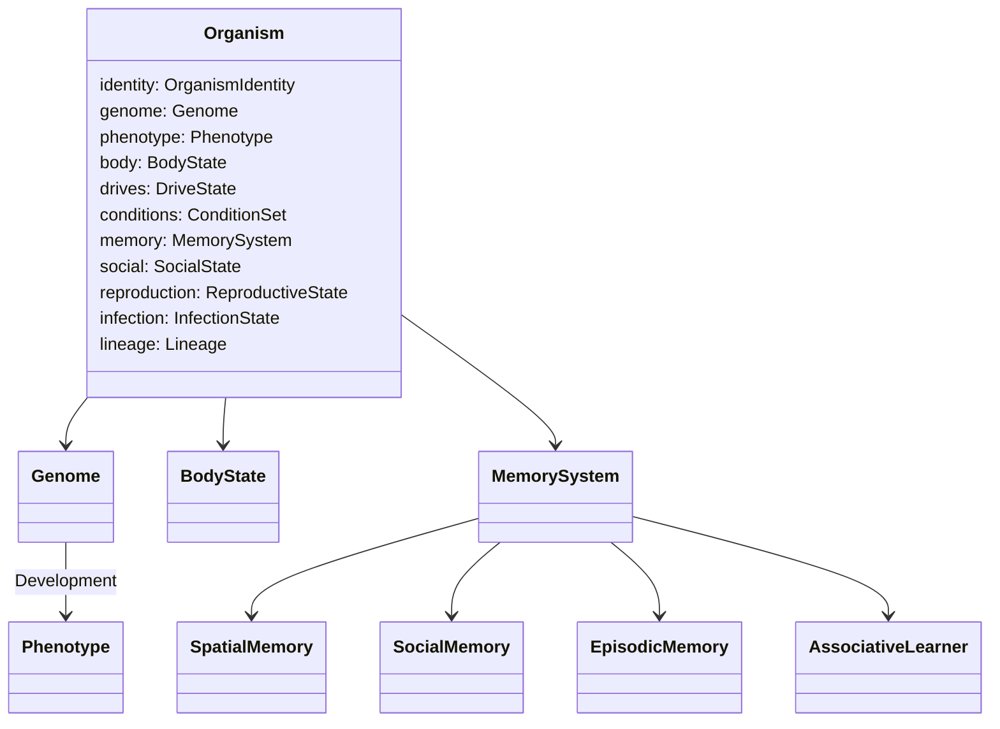

# 04 — Organism Model

An organism is a **motile animal**: a body governed by physiology (code), a genome that builds that body and its temperament (code), and a nervous system that decides what the body does each tick (**Jev**, one call per tick).

---

## 4.1 Identity and lineage

| Attribute | Type | Notes |
| --- | --- | --- |
| `id` | `OrganismId` | Monotonic per world |
| `name` | str | Procedural and pronounceable, for storytelling (for example "Tamsi"). Generated by `IndividualNamer` from species-specific syllable sets |
| `sex` | `female` / `male` | 50:50 at conception |
| `species_id` | `SpeciesId` | Assigned by clustering (see [05 §5.12](05-ecology-rules.md)) |
| `generation` | int | max(parent generations) + 1 |
| `mother_id`, `father_id` | `OrganismId \| None` | `None` for founders |
| `birth_tick`, `death_tick`, `death_cause` | int, int, `DeathCause` | |
| `archetype` | str | Founders only: the archetype they were drawn from |
| `pedigree` | ancestor ids up to great-grandparents | Used for kinship $r$ |

---

## 4.2 Genome

**Diploid, additive.** Each locus carries two alleles in [0, 1]. The genotypic value is their mean, and the phenotype adds developmental noise $\mathcal N(0, \sigma_{dev}=0.03)$, so heritability is below 1, as in real populations. Loci are grouped into **linkage modules**. Within a module, alleles tend to be inherited together (see [05 §5.11](05-ecology-rules.md)).

There are 89 loci: 57 trait loci, 24 instinct loci and 8 neutral marker loci (loci 82–89). The neutral markers have no phenotypic effect; they record drift and act as a molecular clock for the phylogeny ([05 §5.11](05-ecology-rules.md)). Every trait has a **cost**, so no genome is best everywhere (§4.12).

### Morphology module

| # | Gene | Phenotype mapping | Effect | Cost | Visual |
| --- | --- | --- | --- | --- | --- |
| 1 | `body_mass` | log-linear map to 0.2–400 kg (adult asymptote $M_\infty$) | Scales nearly everything allometrically (§4.5) | More food per individual, slower life history | Glyph size $\propto M^{1/3}$ |
| 2 | `limb_ratio` | 0.7–1.4 × speed | Speed and agility | Locomotion cost $+15\%\cdot$gene; fragility $+10\%$ | Elongated body |
| 3 | `armor` | 0–70% damage reduction | Defense | Mass +30%, speed −25%, locomotion cost up | Thick outline, plates |
| 4 | `weaponry` | attack × 0.3–2.5 (teeth, claws, horns) | Offense; retaliation against attackers | BMR +10% | Spikes, horns |
| 5 | `insulation` | thermal conductance −0–70% | Cold tolerance | Heat stress in warm climates | Fuzzy edge |
| 6 | `fat_capacity` | reserve 3–35% of body mass | Starvation buffer, winter survival | Speed −10% when full | Rounder body when fat |
| 7 | `crypsis` | detectability −0–60% in matching cover | Hiding from predators or prey | Lower display attractiveness | Colors blend with terrain |
| 8 | `ornament` | display attractiveness 0–1 | Mate attraction (sexual selection) | Detectability +40%·gene | Crest or bright patch |
| 9 | `toxicity` | toxin dose to anyone who bites it | Secondary defense, aposematism | BMR +15% | Warning pattern if paired with high ornament |
| 10 | `coat_hue` | 0–1 hue | Neutral marker; kin and species recognition | — | Body color |
| 11 | `pattern` | none, spots or stripes | Neutral marker | — | Texture |

### Locomotion module

| # | Gene | Mapping | Effect | Cost |
| --- | --- | --- | --- | --- |
| 12 | `swim_skill` | 0–1 | > 0.5 can enter deep water; swim cost falls with skill | Land locomotion +10%·gene |
| 13 | `climb_skill` | 0–1 | `climb` in forest and rainforest: an escape from non-climbers; fruit access bonus | Mass above 60 kg cannot climb |
| 14 | `dig_skill` | 0–1 | `dig_den`, invertebrate foraging bonus | Slower on hard terrain |
| 15 | `stamina` | 1–6 all-out ticks before exhaustion | Pursuit and escape | BMR +5% |

### Physiology module

| # | Gene | Mapping | Effect | Cost |
| --- | --- | --- | --- | --- |
| 16 | `endothermy` | 0 = ectotherm, 1 = full endotherm | Constant body temperature, performance at night and in cold | BMR × (0.15 + 0.85·gene): ectotherms run at about 15% of endotherm BMR |
| 17 | `thermal_optimum` | 10–40 °C | Center of the thermal performance curve or comfort zone | — |
| 18 | `thermal_breadth` | 4–20 °C | Tolerance width | Peak performance lower when broad (generalist–specialist trade-off) |
| 19 | `metabolic_scope` | 0.7–1.4 | Activity capacity, growth rate | BMR × gene |
| 20 | `water_efficiency` | water loss −0–60% | Desert survival | Digestion efficiency −5%·gene |
| 21 | `toxin_resistance` | 0–1 | Volcanic ground, toxic prey | BMR +6% |
| 22 | `immune_investment` | 0–1 | Susceptibility and recovery | BMR +12% |
| 23 | `healing_rate` | 0.5–2 × base | Wound recovery | Energy per healed unit |
| 24 | `carrion_tolerance` | 0–1 | Eat spoiled meat safely | Fresh-meat efficiency −5% |
| 25 | `longevity` | 0.6–1.4 × lifespan scale | Slower senescence | Lower early fecundity (antagonistic pleiotropy) |

### Diet module

| # | Gene | Mapping |
| --- | --- | --- |
| 26 | `fiber_affinity` | Softmax of genes 26–28 gives the **diet simplex** $d = (d_{fiber}, d_{soft}, d_{animal})$ |
| 27 | `soft_plant_affinity` | Fruit, seeds, algae, fungi |
| 28 | `animal_affinity` | Invertebrates, meat, carrion |
| 29 | `grazer_browser` | Within fiber: 0 = grass specialist, 1 = browse specialist |

Assimilation efficiency for food $f$ in diet class $k$: $e_f = e_{max,f}\cdot\sqrt{d_k}$. A specialist ($d_k = 1$) gets the full $e_{max}$; a perfect generalist ($d_k = 1/3$) gets 58%. That is the realistic jack-of-all-trades penalty.

### Senses module

| # | Gene | Mapping | Cost |
| --- | --- | --- | --- |
| 30 | `visual_acuity` | vision radius 3–12 patches in full light | BMR +5% (expensive tissue) |
| 31 | `night_vision` | light-deficit compensation 0–80% | BMR +4%; slight daytime glare penalty |
| 32 | `olfaction` | scent detection threshold (log scale) | BMR +4% |
| 33 | `hearing` | hearing threshold 10–40 dB | BMR +3% |
| 34 | `vocal_capacity` | call loudness and repertoire (below 0.2 only `silent` is available) | Calling makes it detectable |

### Life-history module

| # | Gene | Mapping | Effect |
| --- | --- | --- | --- |
| 35 | `maturity_rate` | scales the age at maturity 0.6–1.4× | Early breeding versus larger adult size |
| 36 | `offspring_investment` | **r–K axis**: litter size $n = \max(1, \mathrm{round}(8(1-g)^{1.5}))$; each newborn is heavier as $n$ falls | Many small young versus few large ones |
| 37 | `precociality` | 0 = altricial (helpless, short gestation), 1 = precocial (walks at birth, long gestation) | Care needed versus maternal cost |
| 38 | `parental_care` | nursing and guarding propensity (appears as temperament words) | Offspring survival versus parental cost |
| 39 | `breeding_seasonality` | 0 = breeds any time, 1 = only in the preset's breeding season | Timing births with food peaks |
| 40 | `mate_choosiness` | appears in state as "choosy about mates" | Sexual selection strength |

### Temperament module (appears in the state as words)

| # | Gene | Low end → high end |
| --- | --- | --- |
| 41 | `boldness` | timid → fearless |
| 42 | `curiosity` | incurious → very curious |
| 43 | `sociability` | solitary → highly social |
| 44 | `aggression` | peaceable → aggressive |
| 45 | `vigilance` | inattentive → watchful |
| 46 | `patience` | restless → patient (sit-and-wait) |
| 47 | `altruism` | selfish → generous to kin |
| 48 | `territoriality` | roaming → territorial |
| 49 | `activity_phase` | nocturnal (0) → crepuscular (0.5) → diurnal (1); also sets the circadian phase in physiology |

### Decision-style module (used by code when interpreting Jev's answer, never shown in state)

| # | Gene | Mapping | Role |
| --- | --- | --- | --- |
| 50 | `decisiveness` | sampling exponent β ∈ [1, 6] | Sharpens Jev's action distribution before sampling ([07 §7.6](07-jev-nervous-system.md)) |
| 51 | `caution` | shifts the hesitation thresholds | Low Jev confidence → hesitation ([06 §6.8](06-action-catalog.md)) |

These two genes are kept out of the state on purpose. If they were rendered as words and also used for sampling, their effect would be counted twice.

### Cognition module

| # | Gene | Mapping |
| --- | --- | --- |
| 52 | `learning_rate` | Rescorla–Wagner α ∈ [0.05, 0.6] |
| 53 | `memory_capacity` | spatial memory slots 4–16, social slots 3–13, memory half-life 1–8 days |
| 54 | `attention_span` | salience list sizes (entities 4–7). Costs BMR +3% (brain tissue) |

### Meta module

| # | Gene | Mapping |
| --- | --- | --- |
| 55 | `mutation_modifier` | per-locus mutation σ × [0.5, 2]; bounded so mutation rate can evolve without running away |
| 56 | `dispersal` | the young's tendency to leave their natal area; appears as the words "restless to find new ground" when young |
| 57 | `sex_ratio_bias` | reserved; fixed at 0.5 in v1 |

---

## 4.3 Instincts: heritable behavioral tendencies Jev reads

Each instinct has its own **propensity locus** (loci 58–81). An instinct is **expressed** when its genotypic value is above 0.5. The state lists the strongest five expressed instincts, each qualified as "somewhat" (0.5–0.75) or "strongly" (> 0.75).

This is how **behavior evolves without an LLM and without code choosing actions**. Heritable text fragments shape Jev's judgment, and selection keeps the ones that help survival and reproduction.

| # | Instinct key | Wording given to Jev |
| --- | --- | --- |
| 58 | `herd_cohesion` | feels safest close to others of its kind |
| 59 | `freeze_first` | tends to freeze and stay still when it first senses danger |
| 60 | `flee_early` | runs from big sharp-toothed animals at the first sign of them |
| 61 | `mob_predators` | joins others of its kind to harass a predator |
| 62 | `ambush_hunter` | hunts by waiting hidden near places prey visit |
| 63 | `pursuit_hunter` | hunts by chasing prey over long distances |
| 64 | `pack_hunting` | prefers to hunt alongside others of its kind |
| 65 | `scavenging` | is drawn to the smell of carrion |
| 66 | `food_caching` | stores spare food near its den |
| 67 | `den_dwelling` | rests and sleeps in a den or burrow |
| 68 | `water_affinity` | likes to stay near water |
| 69 | `basking` | warms itself in the sun when cold |
| 70 | `open_ground_wariness` | avoids open ground in daylight |
| 71 | `territorial_marking` | marks and defends a home area |
| 72 | `migration_urge` | feels an urge to travel far when the season turns |
| 73 | `nest_building` | prepares a sheltered den before giving birth |
| 74 | `infant_guarding` | stays close to its young and defends them |
| 75 | `sentinel` | keeps watch while others of its kind feed |
| 76 | `alarm_calling` | calls out loudly when it sees danger |
| 77 | `food_sharing` | shares food with its close kin |
| 78 | `play_dead` | goes limp and plays dead when caught |
| 79 | `neophobia` | is wary of unfamiliar things |
| 80 | `neophilia` | is drawn to new things and places |
| 81 | `kleptoparasitism` | steals food from others when it can |

Some instincts conflict, such as `neophobia` and `neophilia`. Both may be expressed, which is realistic ambivalence. Jev weighs them against the situation.

---

## 4.4 Temperament words

Temperament genes are quantized. **Only non-neutral values appear**, which keeps the state short and makes individual differences salient.

| Gene value | < 0.15 | 0.15–0.35 | 0.35–0.65 | 0.65–0.85 | > 0.85 |
| --- | --- | --- | --- | --- | --- |
| `boldness` | very timid | timid | *(omitted)* | bold | fearless |
| `curiosity` | incurious | uninterested in novelty | — | curious | very curious |
| `sociability` | strictly solitary | prefers solitude | — | sociable | highly social |
| `aggression` | very peaceable | peaceable | — | quick to fight | very aggressive |
| `vigilance` | inattentive | easygoing | — | watchful | hyper-vigilant |
| `patience` | very restless | restless | — | patient | extremely patient |
| `altruism` | selfish | self-serving | — | generous to kin | devoted to kin |
| `territoriality` | nomadic | roaming | — | homebound | fiercely territorial |
| `parental_care` | leaves its young to fend for themselves | casual parent | — | attentive parent | devoted parent |
| `mate_choosiness` | mates with any partner | not very choosy | — | choosy about mates | very choosy about mates |

Example rendering: `"temperament": "timid, very curious, highly social, watchful, devoted parent"`.

---

## 4.5 Development: from genotype to phenotype (allometry)

The **exponents are empirical scaling laws**. The **coefficients** are calibration parameters (see [05 §5.16](05-ecology-rules.md)). $M_\infty$ is adult mass, $m$ is current mass, and 1 EU is nominally 1 kJ.

| Quantity | Formula | Basis |
| --- | --- | --- |
| Basal metabolic rate per tick | $B = b_0\, m^{0.75}\,\mu_{met}\,(0.15+0.85\,\epsilon)\,\big(1+\sum_i c_i x_i\big)\,\Theta(T_b)$ | Kleiber's law; endothermy factor $\epsilon$; trait costs $c_i x_i$ (§4.12); thermal factor $\Theta$ |
| Energy reserve capacity | $E_{max} = f_{fat}\, m\, \rho_{fat}$, with $\rho_{fat} = 39{,}000$ EU/kg | Fat energy density |
| Stomach capacity | $S_{max} = 0.025\, m$ kg dry matter | Gut capacity is roughly isometric |
| Bite rate | $i_{max} = i_0\, m^{0.75}$ kg per tick × food handling factor | Intake scaling |
| Top speed | $v_{max} = \mathrm{clip}\big(\mathrm{round}(v_0\, M_\infty^{0.17}\,(0.7+0.7\ell)(1-0.25a)(1-0.1\,\text{fatfill})),\ 1,\ 5\big)$ patches per tick | Running speed ∝ $M^{0.17}$ |
| Locomotion cost per patch | $L = c_{loc}\, m^{0.68}\cdot\text{terrain cost}\cdot\text{effort factor}$ | Cost of transport ∝ $M^{-0.32}$ per kg |
| Attack power | $A = a_0\, m^{0.66}\,(0.3 + 2.2w)\,P(T_b)\,(1 - 0.5\,\text{exhaustion})$ | Muscle cross-section ∝ $M^{2/3}$ |
| Defense | $D = d_0\, m^{0.66}\,(0.5 + a) + \text{agility}(\ell)$ | |
| Wound capacity | $H_{abs} = h_0\, m^{0.66}$ (health is shown as a fraction $H \in [0,1]$) | |
| Water turnover | $w = w_0\, m^{0.80}$ per tick | Mammalian water turnover ∝ $M^{0.8}$ |
| Lifespan scale | $\mathcal L = \ell_0\, M_\infty^{0.25}\,(0.6+0.8\,\text{longevity})$ ticks | Lifespan ∝ $M^{1/4}$ |
| Age at maturity | $A_{mat} = a_{m}\, M_\infty^{0.25}\,(1.4 - 0.8\,\text{maturity rate})$ | ∝ $M^{1/4}$ |
| Gestation | $G = g_0\, M_\infty^{0.25}\,(0.7+0.6\,\text{precociality})$ | ∝ $M^{1/4}$ |
| Weaning age | $A_{wean} = a_w\, M_\infty^{0.25}\,(1.2-0.5\,\text{precociality})$ | |
| Vision radius | $r_{vis} = (3 + 9\,\text{acuity})\sqrt{L + 0.8\,\text{nv}(1-L)}$ | Light-limited |
| Thermal conductance | $C = c_0\, m^{0.5}\,(1-0.7\,\text{insulation})$ | Surface-to-volume |

**Default calendar anchors**, which calibration keeps. For a 2 kg "Burrow Hopper": maturity ≈ 90 ticks (7.5 days), gestation ≈ 30 ticks, lifespan ≈ 900 ticks. For a 60 kg "Stripe Stalker": maturity ≈ 250 ticks, gestation ≈ 70 ticks, lifespan ≈ 2,000 ticks.

**Ontogeny:** newborns start at birth mass $m_b$ and grow by West's ontogenetic growth model when they have an energy surplus:

$$\frac{dm}{dt} = a\, m^{3/4}\Big[1 - \big(m/M_\infty\big)^{1/4}\Big]$$

The growth increment is capped by the available surplus divided by the tissue energy cost. Starved juveniles stay small, which is realistic phenotypic plasticity.

---

## 4.6 Dynamic body state

| Variable | Range / unit | Changes by |
| --- | --- | --- |
| `position`, `heading` | patch, one of 8 directions | movement |
| `mass` $m$ | kg | growth, starvation (catabolism), pregnancy |
| `energy` $E$ | 0–$E_{max}$ EU | digestion in, metabolism out |
| `stomach` | kg per food layer | eating in, digestion out |
| `hydration` $h$ | 0–1 | drinking, wet food in; turnover and evaporation out |
| `body_temperature` $T_b$ | °C | thermal model |
| `health` $H$ | 0–1 | damage, healing |
| `sleep_pressure` $S$ | 0–1 | two-process sleep model |
| `stamina` | 0–1 | drained by hurried and all-out effort, recovers at rest |
| `pain` | 0–1 | spikes on damage, decays with a half-life of 3 ticks |
| `fear` | 0–1 | integrates Jev's `threat` appraisal ([07 §7.6](07-jev-nervous-system.md)) |
| `stress` | 0–1 | slow average of fear and pain (allostatic load); suppresses immunity |
| `parasite_load` | 0–1 | contact in groups up; grooming and wallowing down |
| `toxin_load` | 0–1 | toxic ground and prey up; clearance down |
| `wounds` | list of severity and bleeding | combat, falls, fire |
| `age` | ticks | +1 per tick |
| `carrying` | optional food item | `carry_food`, `drop_food` |
| `den_id` | optional | `dig_den`, `enter_den` |
| `last_actions` | last 3 verbs | recording and state |

---

## 4.7 Drives (computed; given to Jev as words)

| Drive | Formula | Words |
| --- | --- | --- |
| Hunger | $\mathrm{clip}(1 - 0.7\,E/E_{max} - 0.5\,\text{stomach}/S_{max},\,0,\,1)$ | not hungry · peckish · hungry · very hungry · starving |
| Thirst | $\mathrm{clip}\big(1 - h^{1.5},\,0,\,1\big)$ | not thirsty · slightly thirsty · thirsty · very thirsty · parched |
| Sleepiness | $S - A_c\,C(t;\phi)$ from the two-process model | alert · a little tired · tired · very tired · exhausted |
| Thermal feeling | from $T_b$ against the comfort zone (endotherm) or the performance curve (ectotherm) | freezing · cold · comfortable · warm · overheating |
| Pain | `pain` | none · mild · sharp · severe · agonizing |
| Fear | `fear` | calm · uneasy · afraid · terrified |
| Urge to mate | mature × estrus or season × $E/E_{max} > 0.5$ × not pregnant | none · mild · strong · overwhelming |
| Social need | sociability × (1 − nearby kin and kind) | content · lonely · misses its group |
| Parental urge | dependent young × distance to them × parental care | young are close · young are out of sight · cannot find its young |
| Boredom / exploratory urge | curiosity × ticks since a novel percept | settled · restless to explore |

Only drives that are informative this tick appear. Hunger, thirst, sleepiness, thermal feeling and pain always appear; the rest appear when not at baseline.

---

## 4.8 Conditions (status flags)

`asleep`, `hidden`, `in_den`, `climbing`, `swimming`, `pregnant`, `lactating`, `in_estrus`, `juvenile`, `dependent` (unweaned), `injured`, `bleeding`, `limping`, `poisoned`, `infected_latent`, `infected_sick`, `immune`, `exhausted`, `hypothermic`, `overheated`, `dehydrated`, `starving`, `senescent`, `carrying_food`, `being_chased`, `courted_by:<id>`, `guarding_young`, `recently_defeated`.

Each condition has an effect table in code (for example `limping` gives speed × 0.6, and `asleep` gives vision 0 and hearing threshold +20 dB). Relevant conditions appear in the state as plain phrases ("you are limping", "you are pregnant, late term").

---

## 4.9 Senses and perception

Perception is **local, uncertain and trait-dependent**. The reference design's fixed 7×7 window becomes sense-specific ranges driven by the genome.

### Vision (`VisionSense`)

For each candidate entity within $r_{vis}$ (found through the spatial hash):

1. **Line of sight:** a Bresenham ray from viewer to target. Transmittance $\tau = \prod (1 - \text{opacity}_k)$ over the patches it crosses; rock that is higher than the viewer blocks it completely.
2. **Detection probability:**
$$
p_{det} = 1 - \exp\!\Big(-\kappa\,\frac{\text{acuity}\cdot L_{eff}\cdot A_{target}\cdot(1 - \chi\,\text{cover}\cdot\text{crypsis})\cdot m_{motion}\cdot m_{display}\cdot\tau}{d^2}\Big)
$$
   - $A_{target} \propto M_{target}^{2/3}$ (apparent size)
   - $m_{motion} = 1.6$ if the target moved at hurried or all-out effort, 0.5 if frozen, stalking or hiding
   - $m_{display} = 1 + 0.4\,\text{ornament}$, raised further by calls and displays
   - a sleeping viewer detects nothing by vision
3. **Identification certainty** uses the same formula with a stricter threshold. It decides how the entity is described:

| Certainty | Description given to Jev |
| --- | --- |
| < 0.35 | "an unclear shape, {size word}" |
| 0.35–0.7 | "{size word} {armament word} animal" (for example "a large sharp-toothed animal") plus what it is visibly doing |
| > 0.7 | adds species identity if known from memory ("a Stripe Stalker") and individual identity if known ("your mother", "the rival who beat you") |

### Olfaction (`OlfactionSense`)

For each scent channel: $c = C(x,y)$, gradient $\nabla C$ by central difference over the 3×3 neighborhood (with wrap). The channel is perceived if $c > \theta_{smell}(\text{olfaction})$.

- Intensity words: faint · clear · strong · overwhelming (log bins over the threshold ratio)
- Direction: $\arg\max$ neighbor concentration, quantized to 8 directions, plus "upwind" or "downwind" relative to the wind
- A musk channel is described through the association the organism has learned: "scent of a kind that has hurt you, strong, from the north"

### Hearing (`HearingSense`)

Each audible `SoundEvent` from last tick (see [03 §3.12](03-world-model.md)) is perceived with a kind (a call type if the listener's species shares the call repertoire, otherwise "a loud call", "a crash", "a scream", "footsteps"), a loudness word and a bearing with acuity-dependent error.

### Touch (`TouchSense`)

Entities in adjacent patches are **always** perceived, even while asleep: "something is touching you". Being attacked always wakes the victim.

### Interoception

Body state, drives and conditions (§4.6–4.8), rendered as words.

### Perceptual field

`PerceptualField` is the set of entity, scent, sound and body percepts for this tick. The `SalienceRanker` trims it for the state (see [07 §7.4](07-jev-nervous-system.md)). Everything perceived, including what was trimmed, updates memory.

---

## 4.10 Memory and learning (code), which Jev sees as words

| System | Contents | Capacity and decay | How it appears in the state |
| --- | --- | --- | --- |
| **Spatial memory** | places: water, food patches, dens, danger spots, safe refuges, each with quality and valence | 4–16 slots (gene); confidence $e^{-\text{age}/\tau}$ | "water: a pond far to the west (seen yesterday)" |
| **Social memory** | known individuals: mother, offspring, mates, rivals, attackers, allies | 3–13 slots; bonds decay | "P3 is your sister", "P2 attacked you two days ago" |
| **Episodic memory** | the last 5 salient events (attacked, found water, lost young, mated, won or lost a contest) | FIFO by salience | "earlier today you escaped a big sharp-toothed animal near the river" |
| **Associative values** | valence $V_s$ per stimulus class: other species, terrain types, food layers, call types, remembered places | continuous | "you associate that kind with pain (strongly)" |
| **Habituation** | exposure counts per stimulus | novelty $n = 1/(1 + h\cdot\text{exposures})$ | "unfamiliar" or "familiar" descriptors |

**Associative learning** uses the Rescorla–Wagner rule, applied in `LearningPhase` from this tick's outcomes:

$$\Delta V_s = \alpha_s\,\beta\,(\lambda - V_s)$$

Here $\alpha_s$ is learning rate × stimulus salience (with a bonus for the stimulus Jev chose as `focus`), and $\lambda$ is the outcome: −1 injury, −0.5 chased or frightened, +0.5 food found, +1 successful mating, 0 harmless exposure (extinction).

**Social transmission:** at weaning, a juvenile copies its mother's three most valuable spatial memories at half confidence. Like elephant matriarch knowledge, this lets traditions such as waterhole routes persist across generations.

The reference design compiled experience into code reflexes through an LLM. Here experience becomes **associations and memories that Jev reads**. The animal still gets faster and more reliable with experience, because its state becomes more decisive and its confidence rises, while Jev remains the only thing that chooses.

---

## 4.11 Social attributes

| Attribute | Model |
| --- | --- |
| **Dominance** | Elo rating, starting at 1000. After a contest, $R_w \mathrel{+}= K(1-E_w)$ with $E_w = 1/(1+10^{(R_l-R_w)/400})$ and $K = 32$. The state shows relative words: "you outrank P4", "P5 dominates you" |
| **Bonds** | Affiliation strength per known individual, increased by grooming, sharing and proximity; half-life 4 days |
| **Kinship** | Pedigree relatedness $r$: parent–offspring 0.5, full siblings 0.5, half siblings 0.25, grandparent 0.25. Words: "your mother", "your full brother", "a cousin" |
| **Group** | Conspecifics within 3 patches, as connected components. Words: "you are with a small group (3–5) of your kind" |
| **Home range and territory** | Centroid of recent positions plus the organism's territory marks; intruders are perceived as "an intruder in your home area" |

---

## 4.12 Trade-offs: no Darwinian demons

Every advantage has a price. Otherwise evolution produces a single unbeatable super-organism.

| Trait ↑ | Benefit | Price |
| --- | --- | --- |
| Body mass | Power, defense, fasting endurance, heat retention | Absolute food need, slow life history, cannot climb or hide, occupancy |
| Speed (limbs) | Escape and pursuit | Locomotion cost, fragility |
| Armor | Damage reduction | Mass, speed |
| Weaponry | Kills, retaliation | BMR |
| Endothermy | Activity at any temperature | About 6.7× the energy of an ectotherm |
| Insulation | Cold survival | Overheating in warm seasons |
| Fat capacity | Starvation buffer | Speed when full |
| Crypsis | Hides from predators or prey | Weaker displays, so lower mating success |
| Ornament | Mating success | Predation risk |
| Toxicity | Predators learn to avoid it | BMR; only pays once predators have learned (frequency dependence) |
| Senses (each) | Earlier detection | BMR (expensive tissue) |
| Immune investment | Disease resistance | BMR |
| Diet specialization | Higher assimilation of one food type | Vulnerable when that food fails |
| Litter size (r) | Fast growth in good times | Weak, small young with high juvenile mortality |
| Longevity | More breeding seasons | Lower early fecundity |
| Social tendencies | Dilution, many eyes, cooperative hunting | Competition within the group, disease transmission |

---

## 4.13 Founder archetypes

Founders are drawn from archetype means plus per-allele noise $\mathcal N(0, 0.06)$, so every world starts with **standing genetic variation** for selection to act on.

| Archetype | Niche | $M_\infty$ | Diet simplex (fiber / soft / animal) | Signature genes | Signature instincts | Activity |
| --- | --- | --- | --- | --- | --- | --- |
| **Meadow Grazer** | Herding grazer | 40 kg | 0.85 / 0.10 / 0.05 | limb 0.6, vigilance 0.7, sociability 0.85, endothermy 1 | herd_cohesion, flee_early, alarm_calling, migration_urge | diurnal |
| **Thicket Browser** | Solitary browser | 90 kg | 0.80 / 0.15 / 0.05 (browse) | armor 0.3, crypsis 0.6, weaponry 0.4 (horns) | freeze_first, open_ground_wariness | crepuscular |
| **Burrow Hopper** | Small r-strategist granivore | 2 kg | 0.40 / 0.55 / 0.05 | dig 0.8, investment 0.2, maturity rate 0.8 | den_dwelling, freeze_first, food_caching | crepuscular |
| **Stripe Stalker** | Solitary ambush carnivore | 60 kg | 0.02 / 0.03 / 0.95 | weaponry 0.85, crypsis 0.7, patience 0.8 | ambush_hunter, territorial_marking | nocturnal–crepuscular |
| **Pack Runner** | Social pursuit carnivore | 25 kg | 0.05 / 0.05 / 0.90 | stamina 0.8, limb 0.75, sociability 0.8 | pursuit_hunter, pack_hunting, food_sharing | crepuscular |
| **Bristle Forager** | Omnivore generalist | 15 kg | 0.30 / 0.40 / 0.30 | dig 0.5, curiosity 0.7, thermal breadth 0.7 | neophilia, kleptoparasitism | diurnal |
| **Carrion Strider** | Scavenger | 10 kg | 0.05 / 0.10 / 0.85 | olfaction 0.9, carrion tolerance 0.9, stamina 0.7 | scavenging, kleptoparasitism | diurnal |
| **Shell Crawler** | Armored slow ectotherm | 5 kg | 0.40 / 0.30 / 0.30 | endothermy 0.1, armor 0.85, limb 0.2, longevity 0.9 | basking, play_dead | diurnal |
| **Reed Wader** | Amphibious omnivore | 8 kg | 0.20 / 0.40 / 0.40 (algae, invertebrates) | swim 0.8, water efficiency 0.2 | water_affinity, sentinel | diurnal |
| **Grub Snuffler** | Nocturnal insectivore | 1 kg | 0.05 / 0.15 / 0.80 (invertebrates) | night vision 0.8, olfaction 0.8, dig 0.6 | den_dwelling, neophobia | nocturnal |

Preset-specific founders (for example cave-adapted or toxin-tolerant lineages) are defined as archetype overrides in the world files (see [08](08-world-settings.md)).
