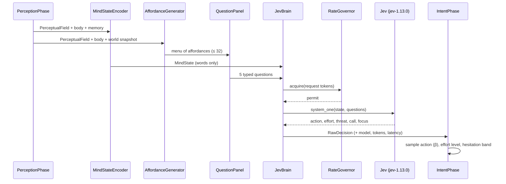

# 07 — The Jev Nervous System: One Call per Organism per Tick

This is the novel core of Lifeform. Every living animal, every tick, makes **exactly one** `system_one` call. That call carries everything the animal is aware of and five simultaneous questions. The answers become its action, effort, danger appraisal, vocalization and attention.



---

## 7.1 The call contract

| Item | Value |
| --- | --- |
| Calls per organism per tick | **exactly 1** (rule J1). Newborns, juveniles, sleepers and the dying all get their call |
| Model | pinned `jev-1.13.0`; `response.model` is logged on every decision |
| State | a JSON object of **words only** (§7.2); target 600–900 tokens, hard cap 1,500 |
| Questions | 5: `action` (Choice), `effort` (Score), `threat` (Score), `call` (Choice), `focus` (Choice) |
| Expected size | about 1,300 input tokens per call (the output is free) |
| Expected cost | about $0.000055 per call, or $0.0055 per 100 organism-ticks |
| Failure policy | Retry and, if necessary, wait. A code-chosen action is never substituted (J12) |

---

## 7.2 The mind state

The state is written from the animal's own point of view. `"you"` always means the animal; the `task` field says so explicitly because Jev reads literally. Here is a complete example for a lactating grazer at dusk with a stalking predator:

```json
{
  "task": "This is one wild animal's experience of this moment. 'You' means this animal.",
  "you": {
    "kind": "a medium-sized plant-eater of the Meadow Grazer kind, female, young adult",
    "body": "slender and fast over long distances; blunt teeth; no horns or armor",
    "diet": "eats grass and some leaves; cannot digest meat",
    "temperament": "timid, highly social, watchful, devoted parent",
    "instincts": [
      "strongly feels safest close to others of its kind",
      "strongly runs from big sharp-toothed animals at the first sign of them",
      "somewhat calls out loudly when it sees danger"
    ]
  },
  "feelings": {
    "hunger": "hungry",
    "thirst": "thirsty",
    "tiredness": "a little tired",
    "temperature": "comfortable",
    "pain": "none",
    "fear": "uneasy"
  },
  "conditions": ["you are nursing a young calf"],
  "time": "dusk, late dry season, clear sky",
  "here": "open grassland; the grass is short and grazed down; no water; no cover",
  "around_you": [
    {
      "id": "P1",
      "what": "a big sharp-toothed animal, a Stripe Stalker",
      "where": "near, to the north-east",
      "doing": "creeping toward you",
      "facts": "faster than you over a short dash, slower over a long run; much bigger than you; has probably noticed you",
      "you_remember": "a Stripe Stalker killed one of your herd two days ago"
    },
    {
      "id": "P2",
      "what": "your calf",
      "where": "beside you, to the south",
      "doing": "resting",
      "facts": "hungry; too young to run far"
    },
    {
      "id": "P3",
      "what": "a group of about six of your kind",
      "where": "mid-distance, to the west",
      "doing": "grazing",
      "facts": "open ground between you and them"
    },
    {
      "id": "P4",
      "what": "an unclear shape, small",
      "where": "far, to the south-east",
      "doing": "still"
    }
  ],
  "smells": [
    "water, faint, from the west",
    "a Stripe Stalker's scent, clear, carried on the wind from the north-east"
  ],
  "sounds": ["an alarm call from your kind, loud, from the west, just now"],
  "memories": [
    "water: a pond, far to the west (seen yesterday)",
    "good grass: along the river, far to the south-west (seen three days ago)",
    "danger: Stripe Stalkers often lurk in the thicket to the north"
  ],
  "recent": ["grazed", "grazed", "looked around"]
}
```

**What is deliberately absent:** coordinates, raw numbers, counts, other animals' internal states (only visible cues), anything the animal could not have sensed or remembered, and anything about the future.

---

## 7.3 Vocabulary: numbers become words (`Quantizer`, `Lexicon`)

All bin edges are configuration. Every quantizer is a small class with one method, `word(value) -> str`.

| Quantity | Words (by bin) |
| --- | --- |
| Distance (patches) | beside you (1) · very near (2) · near (3–4) · mid-distance (5–7) · far (8–12) · very far (13+) |
| Direction | north · north-east · east · south-east · south · south-west · west · north-west (+ "upwind" or "downwind") |
| Relative size ($M_{other}/M_{self}$) | tiny next to you (< 0.1) · much smaller · smaller · about your size · bigger · much bigger · enormous next to you (> 10) |
| Relative speed | much slower · slower · about as fast · faster · much faster; split into "over a short dash" and "over a long run" when burst and stamina disagree |
| Group size | alone · a pair · a few (3–5) · about six to ten · a large group (11+) |
| Scent intensity | faint · clear · strong · overwhelming |
| Loudness | faint · clear · loud · deafening |
| Recency | just now · earlier today · yesterday · two or three days ago · many days ago |
| Certainty | an unclear shape (< 0.35) · morphology words (0.35–0.7) · named kind or individual (> 0.7) |
| Life stage | newborn · juvenile · young adult · adult · old |
| Food amount | none · sparse · some · plenty · lush |
| Health (self) | healthy · slightly hurt · wounded · badly wounded · near death |
| Drives | per [04 §4.7](04-organism-model.md) |

**Relational facts** (`RelationalFacts`, design rule J3) are computed in code and stated plainly:

- faster or slower (burst and endurance), bigger or smaller, stronger or weaker (the $A/D$ ratio);
- "has noticed you", "probably" or "has not noticed you" (from the other animal's own perception this tick);
- "deep water lies between you", "it cannot climb", "it cannot follow you into the den";
- "carrying food", "wounded", "looks sick", "asleep", "lying limp, seems dead";
- kinship ("your calf", "your half-brother") and dominance ("dominates you", "you outrank it").

---

## 7.4 Salience and the state budget (`SalienceRanker`)

Jev's accuracy falls with irrelevant context, so the state includes only what matters most.

$$
\text{salience}(e) = w_d\frac{1}{1+d} + w_t\,\text{danger prior}(e) + w_n\,\text{need match}(e) + w_k\,\text{kin}(e) + w_v\,\text{novelty}(e) + w_a\,[\text{approaching}]
$$

- The **danger prior** combines visible morphology (weaponry, size ratio, carnivore teeth) with the learned association $V_s$.
- **Need match** checks whether the entity satisfies a current drive: food when hungry, water when thirsty, a mate when in estrus, young when separated.

| Section | Kept |
| --- | --- |
| `around_you` | top $k$ entities, where $k$ = attention span (4–7) |
| `smells` | top 3 |
| `sounds` | top 3 |
| `memories` | top 4 by need match and recency |
| `recent` | the last 3 verbs and outcomes |

A `TokenEstimator` (characters / 4, re-fitted against real `usage.input_tokens`) enforces the cap. Trimming order: lowest-salience entities first, then memories, then smells and sounds beyond two each.

Everything perceived still updates memory, even when trimmed from the state.

---

## 7.5 The question panel (`QuestionPanel`)

All wording lives in one versioned `PanelWording` object, so the Question Lab can A/B-test phrasing. The panel version is recorded in the manifest.

### `action`: Choice over the affordance menu

- **Instructions:** "Choose the one option this animal takes during the next two hours. Like a real wild animal, it acts on its strongest feelings, its temperament and instincts, and what it senses and remembers, in order to stay alive, stay well, raise its young and breed."
- **Criteria:** the menu from [06 §6.6](06-action-catalog.md): at most 32 `key → description` pairs, shuffled per call. Example for the state above:

```json
{
  "flee_from_P1": "run away from P1 across open ground; the herd is to the west",
  "flee_to_herd_west": "run west to join the group of your kind",
  "defend_young": "stand over your calf, braced to fight",
  "stay_with_group": "move toward your group to the west",
  "follow_P2": "stay beside your calf",
  "nurse_P2": "let your calf suckle",
  "graze_here": "eat the short grass here (sparse)",
  "go_to_water_memory_1": "head for the pond far to the west",
  "follow_scent_water": "follow the faint smell of water to the west",
  "scan_surroundings": "stop and look around carefully",
  "freeze": "stand completely still",
  "threat_display_at_P1": "stamp and snort at P1",
  "investigate_P4": "go carefully closer to the small unclear shape",
  "rest": "rest where you are",
  "sleep": "sleep here",
  "move_north": "walk north",
  "move_south": "walk south"
}
```

### `effort`: Score, 4 levels

- **Instructions:** "How much physical effort does this animal's situation call for right now?"
- **Criteria:**
  - 0 "minimal: nothing is pressing; save energy"
  - 1 "steady: an ordinary, sustainable pace"
  - 2 "hurried: something needs doing soon and is worth extra energy"
  - 3 "all-out: life or death right now; a maximum burst"

### `threat`: Score, 5 levels

- **Instructions:** "How much danger is this animal in right now?"
- **Criteria:**
  - 0 "none: nothing threatening is sensed"
  - 1 "low: a possible threat, distant or unclear"
  - 2 "moderate: a real threat is present but not close, or not focused on this animal"
  - 3 "high: a dangerous animal or hazard is close or coming closer"
  - 4 "deadly: it is being attacked or is about to be"

### `call`: Choice over the legal calls

- **Instructions:** "Which call does this animal make now?"
- **Criteria:** only the calls legal for this animal ([06 §6.4](06-action-catalog.md)), always including `"silent": "makes no sound"`, which is the explicit none-option.

### `focus`: Choice over salient percepts

- **Instructions:** "Which single thing around this animal matters most to it right now?"
- **Criteria:** the entity ids (`P1…`), smell ids (`S1…`) and sound ids (`H1…`) in the state, each with a short label, plus `"nothing_in_particular": "nothing stands out"`.

**Wording rules applied** (J6): questions are positive and literal and ask for one judgment each. Criteria extend the instructions and never contradict them. Explicit none-options exist wherever "nothing" is a valid answer.

---

## 7.6 Interpreting the answers (`DecisivenessSampler`, `HesitationRule`)

| Answer | Interpretation |
| --- | --- |
| `action.probabilities` $p(a)$ | **Sample** $a \sim \pi(a) = p(a)^{\beta} / \sum_b p(b)^{\beta}$, where $\beta \in [1, 6]$ comes from the `decisiveness` gene, using the seeded decision stream. $\beta = 1$ follows Jev's distribution exactly; $\beta = 6$ is close to always taking the top option. The sampled action and the argmax are both recorded; a mismatch is logged as "exploratory" |
| `action.confidence` $c$ | Decisive, hesitant or dithering band ([06 §6.8](06-action-catalog.md)) |
| `effort.score` | Level = round(expected score), then hesitation adjustment |
| `threat.score` $\theta \in [0, 4]$ | **Fear update:** $\text{fear}_{t+1} = (1-\varphi)\,\text{fear}_t + \varphi\,\theta/4$ with $\varphi = 0.6$. Stress (the slow average) rises with fear. `threat ≥ 3` marks the tick as **urgent** |
| `call.probabilities` | Sampled with the same $\beta$ |
| `focus.choice` | The attention target: Rescorla–Wagner learning bonus ×2 for that stimulus this tick, and a gaze line in the replay |

Fear is therefore **appraised by Jev** and **integrated by code**. That realizes the reference design's "fear" drive without a hand-written formula for danger.

---

## 7.7 How the genome reaches the decision

Behavioral evolution only works if heritable variation changes Jev's choices. Every behavioral gene has an explicit path:

| Genome part | Path into the call | Mechanism |
| --- | --- | --- |
| Morphology (mass, weaponry, armor, limbs) | `you.body`, and relational facts about others ("faster than you") | What the animal *can* do shapes what Jev judges sensible |
| Diet simplex | `you.diet` and **menu legality** (no grazing for pure carnivores) | Niche shapes options |
| Senses | *What* appears in `around_you`, `smells` and `sounds`, and how certainly | Better senses mean earlier, clearer information |
| Temperament (9 genes) | `you.temperament` words | Jev weighs a "timid" animal differently from a "fearless" one |
| Instincts (24 genes) | `you.instincts` phrases | Heritable behavioral dispositions |
| Mate choosiness, parental care | temperament words | Sexual selection and care strategies |
| Decisiveness, caution | sampling $\beta$ and hesitation thresholds (**not** in the state) | How reliably and how vigorously Jev's judgment is acted on |
| Memory capacity, learning rate, attention span | How much memory and how many entities appear, and how fast associations form | Cognitive evolution |

**This depends on an empirical claim**: that Jev's answers are sensitive to temperament and instinct text. The Question Lab (§7.11, suite 4) verifies it before any long run. It is the single most important gate in the project.

---

## 7.8 How learning reaches the decision

The reference design turned experience into code reflexes through an LLM. Here experience changes *what Jev reads*:

- **Associations** ("you associate Stripe Stalkers with pain, strongly") come from Rescorla–Wagner updates.
- **Memories** of places, individuals and episodes let an experienced animal know where water is.
- **Recognition:** species and individuals become *named* in the state once they are known, instead of "an unclear shape".
- **Outcomes:** failures appear in `recent` ("tried to eat, but the carcass was gone").

As experience accumulates, the state becomes more *decisive*, so Jev's confidence rises and hesitation falls. **The organism gets faster and more reliable with experience** without any code reflexes.

---

## 7.9 The Brain port and its adapters

```python
class Brain(Protocol):
    async def decide(self, mind: MindState, panel: QuestionPanel) -> RawDecision: ...
    async def close(self) -> None: ...


class JevBrain:
    def __init__(self, gateway: JevGateway, codec: PanelCodec) -> None:
        self._gateway = gateway
        self._codec = codec

    async def decide(self, mind: MindState, panel: QuestionPanel) -> RawDecision:
        request = self._codec.encode(mind, panel)
        response = await self._gateway.ask(request)
        return self._codec.decode(mind.organism_id, panel, response)

    async def close(self) -> None:
        await self._gateway.close()
```

| Component | Responsibility |
| --- | --- |
| `JevGateway` | Owns the single `AsyncTypeSafeClient` per process: `RetryPolicy(max_retries=4, backoff_initial=0.5, backoff_max=8, timeout=60)` and a 5 s per-request timeout. Acquires permits from the `RateGovernor`. Maps SDK exceptions to `BrainUnavailable` (retryable) or `BrainMisuse` (a bug, fail fast) |
| `RateGovernor` | Two token buckets (requests per minute, tokens per second) starting at 90% of the published limits. AIMD: halve on 429, add 5% after each clean minute. Round-robin queues per world for fairness |
| `PanelCodec` | The **only** place SDK types appear: converts `QuestionPanel` into `Choice`, `Score` and `Noul` objects, and `SystemOneResponse` into `RawDecision` |
| `TapeBrain` | Serves recorded `RawDecision`s by (tick, organism) for bit-exact re-simulation |
| `ScriptedBrain` | Returns programmed distributions for unit and scenario tests |
| `HeuristicBrain` | **Development only**, for pipeline smoke tests with no API key. Runs using it are stamped `brain: heuristic`, and the theater shows a "not Jev" banner. The `production` profile refuses to use it |

**Tick-level failure handling (J12):** if any organism's call raises `BrainUnavailable` after the gateway's retries, `DeliberationPhase` re-queues only the failed organisms with exponential backoff (1 s → 10 min). The tick completes only when every organism has a decision. After 10 minutes of failure, the world checkpoints and **pauses**. The `stalled` outcome exists solely as an explicit, operator-approved escape hatch (`--allow-stalls`), and it is counted in the manifest.

---

## 7.10 Decision records (the decision tape)

One record per organism per tick:

| Field | Content |
| --- | --- |
| `tick`, `world_id`, `organism_id`, `species_id` | Identity |
| `state` | The exact JSON sent |
| `menu` | Option keys, descriptions, presented order, plus the pruned candidates with their relevance |
| `panel_version`, `questions_hash` | Wording provenance |
| `answers` | All five answers with full probability distributions and confidence |
| `sampled_action`, `argmax_action`, `band`, `effort_level`, `threat_score`, `call`, `focus` | Interpretation |
| `outcome` | Executed, `failed:<reason>`, or `stalled` |
| `model`, `input_tokens`, `latency_ms`, `attempts` | Operations |

The tape powers four things: exact re-simulation (`TapeBrain`), the theater's **mind inspector**, behavioral analytics (action frequencies, confidence distributions by species and generation), and model-drift audits.

---

## 7.11 The Question Lab (`lifeform lab run`)

This is a small, cheap test harness that runs **before the first real simulation** and again on any model or wording change. It uses about 600 calls, roughly $0.03.

| Suite | What it measures | Gate |
| --- | --- | --- |
| **1. Behavior sanity** | About 60 hand-built scenarios (YAML in `lab/`), each with an *acceptable action set*. Examples: a predator adjacent to a timid prey; thirsty next to water; starving on food; courted by a conspecific; a mother whose young are threatened; a carnivore offered prey it learned is toxic; a lone juvenile at night; fire upwind | ≥ 85% of sampled actions (β = 3) fall in the acceptable set |
| **2. Calibration** | Reliability of `action.confidence` against the acceptable-set hit rate; Spearman correlation of `threat` with the scenario's ground-truth danger | Monotone reliability curve; ρ ≥ 0.7 |
| **3. Position bias** | 20 scenarios × 8 shuffles of the menu | No position gets more than 1.5× its expected share |
| **4. Temperament sensitivity** | Paired scenarios that differ **only** in temperament or instinct lines (for example `fearless` vs `very timid`, or with and without `herd_cohesion`) | Mean shift ≥ 0.15 in probability mass on the relevant options. **This is the project's key gate** (§7.7) |
| **5. Wording A/B** | Alternative instructions for each question, scored on suites 1–4 | The best variant becomes the `PanelWording` default |
| **6. Token budget** | State plus panel size across all scenarios | p95 ≤ 1,500 tokens |
| **7. Version regression** | Re-run all suites when `response.model` changes | No suite regresses by more than 5 points |

**If suite 4 fails,** the escalation path is: stronger and more concrete instinct phrasing ("runs at once from…" rather than "tends to avoid…"), moving the temperament line to the top of `you`, and adding one temperament-aware sentence to the `action` instructions. If none of those work, the plan still stands. Morphology, senses, diet, memory and the sampling genes still evolve, and temperament evolution becomes a reported negative result.

---

## 7.12 Cost and throughput controls

| Control | Where |
| --- | --- |
| Pre-run estimate (calls, wall time, dollars) | `lifeform estimate` ([01 §1.8](01-jev-research.md)) |
| Global rate governor | `RateGovernor` (§7.9) |
| Hard budget stop at a checkpoint | `BudgetGuard` (`--budget-usd`, `--max-calls`) |
| Population kept in the affordable band | Calibration ([05 §5.16](05-ecology-rules.md)) |
| Decision-tape detail | `--decision-detail full \| summary \| none` (disk only; it does not affect calls) |
| Optional `economy` mode (**off** by default) | Lets Jev choose multi-tick commitments (for example "sleep until disturbed"). It breaks rule J1, so it is stamped in the manifest and shown in the theater |
