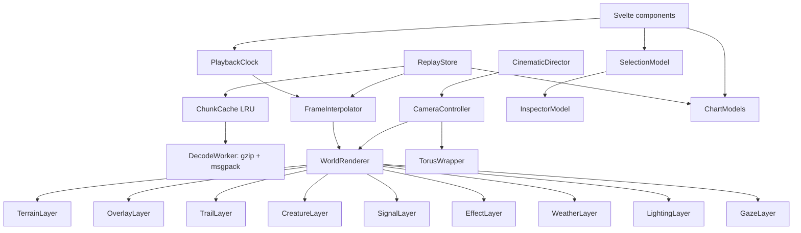

# 09 — Recording, Replay and Visualization

The simulator is slow, because Jev throughput caps it at about 20 decisions per second. The theater is fast, beautiful and exact. Python records **everything** into a run bundle, and the browser plays it back at any speed, with any camera, with no API calls.

---

## 9.1 Goals

| Goal | Meaning |
| --- | --- |
| **Faithful** | The replay shows exactly what was simulated: positions, sub-step paths, actions, events and fields. Nothing is re-simulated or invented |
| **Aesthetic** | A living diorama: painterly terrain, day–night light, weather, expressive procedural creatures, and event effects |
| **Explorable** | Click any animal at any tick to see what Jev was given and what it answered |
| **Analytical** | Population, trait, phylogeny and behavior charts linked to the timeline |
| **Shareable** | Screenshots, WebM clips and an automatic highlight reel |
| **Performant** | 60 fps on a mid-range laptop with a 192² world and 300 creatures |

---

## 9.2 Run bundle format

```text
runs/<run_id>/
├── manifest.json                    run metadata (below)
├── worlds/<world_slug>/
│   ├── static/terrain.u8.gz         terrain ids (H×W)
│   ├── static/elevation.u16.gz      elevation (H×W)
│   ├── index.json                   chunk ranges, keyframe ticks, byte sizes
│   ├── frames/000000-000047.msgpack.gz
│   ├── fields/000000-000047.msgpack.gz
│   ├── events.msgpack.gz
│   ├── organisms.msgpack.gz         registry: genome, lineage, names, life summary
│   ├── species.json                 species registry and phylogeny
│   ├── stats.msgpack.gz             per-tick time series
│   ├── chronicle.json               highlights (templated narrative)
│   └── decisions/000000-000047.msgpack.gz
└── checkpoints/                     not served to the web
```

**Chunking:** 48 ticks (4 simulated days) per chunk, so the browser fetches only what the playhead needs. Every file is **msgpack + gzip**, which the browser decodes natively with `DecompressionStream` and `@msgpack/msgpack`. No WASM is needed. Chunks are written to a temporary file and renamed atomically.

### `manifest.json`

It records the run id, git SHA, `RunConfig` and preset hashes, seed, brain (`jev`, `tape`, `heuristic`), pinned model and every `response.model` seen, `PanelWording` version, calendar, grid sizes, palette ids, tick range completed, status (`complete`, `budget_reached`, `paused`, `population_ceiling`), totals (calls, tokens, cost, wall time), interventions (immigration, economy mode, stalls) and the phase order.

### Organism frames (per tick, columnar arrays)

| Column | Type | Notes |
| --- | --- | --- |
| `id` | u32 | |
| `species` | u16 | |
| `x`, `y` | u16 | end-of-tick position |
| `path` | 5 × (i8, i8) | sub-step offsets, so chases animate exactly |
| `heading` | u8 | 0–7 |
| `verb` | u8 | verb catalog index |
| `target` | u32 | 0 for none |
| `effort`, `band` | u8, u8 | band is decisive, hesitant or dithering |
| `call` | u8 | |
| `focus` | u32 | |
| `confidence` | u8 | × 255 |
| `energy`, `hydration`, `health`, `fear`, `sleepiness` | u8 each | × 255 |
| `mass` | u16 | in 10 g units |
| `flags` | u32 | condition bitfield |
| `outcome` | u8 | executed or failed reason |

That is about 60 bytes per organism-tick. At 100 organisms × 1,500 ticks it is about 9 MB raw, or about 2 MB gzipped per world.

**Per-tick globals:** tick of day, season, light, weather state, wind vector, climate anomaly, and live counts.

### Field keyframes

- Every 6 ticks (twice per day): 7 food layers (u8, log-quantized), surface water, snow, fire, toxin and total pathogen (u8 each).
- Every 48 ticks: canopy, soil nutrients, and temperature (u8 mapped from −50 to 60 °C).
- Optional: scent channels at half resolution (`--record-scent`).
- **XOR delta against the previous keyframe before gzip.** Vegetation changes slowly, so this compresses about 5–10×. The browser interpolates between keyframes on the GPU.

### Events (`events.msgpack.gz`)

Each event is `{tick, kind, actors[], position, payload}`. Kinds: `birth`, `death{cause, killer}`, `strike{hit, damage}`, `kill`, `mating`, `conception`, `miscarriage`, `weaning`, `maturity`, `contest{winner}`, `speciation{parent, child}`, `extinction`, `infection{strain}`, `outbreak`, `fire_start`, `eruption`, `rift_open`, `rafting`, `drought_start`, `den_built`, `migration_detected`.

### Decisions (`decisions/*.msgpack.gz`)

These are the decision-tape records from [07 §7.10](07-jev-nervous-system.md), chunked like frames and loaded lazily when the inspector opens. At full detail, expect about 3–5 KB per decision before gzip (about 150–250 MB per standard world, about 30–50 MB gzipped). Use `--decision-detail summary` to drop the state text and keep the answers.

---

## 9.3 Recorder (Python)

| Class | Responsibility |
| --- | --- |
| `Recorder` | `EventBus` subscriber; orchestrates the encoders at `RecordingPhase` |
| `FrameEncoder` | Organism state to columnar numpy arrays per tick, then chunks |
| `FieldKeyframeEncoder` | Quantization, XOR delta, and scheduling per layer group |
| `EventLog` | Domain events to compact records |
| `StatsCollector` | Per-tick time series: populations per species, trait means and variances per species, births and deaths by cause, biomass per trophic level, vegetation totals, diversity (Shannon), decision analytics |
| `DecisionTapeWriter` | Records from `DeliberationPhase` and `IntentPhase` |
| `ChronicleWriter` | Templated narrative highlights ([10 §10.2](10-analysis-testing-roadmap.md)) |
| `ChunkWriter` | msgpack, gzip and atomic rename |
| `ManifestWriter` | Updated at every checkpoint and at the end of the run |

---

## 9.4 Server (FastAPI)

| Endpoint | Purpose |
| --- | --- |
| `GET /api/runs` | List runs with manifest summaries |
| `GET /api/runs/{run}/manifest` | Manifest |
| `GET /api/runs/{run}/worlds/{world}/{path}` | Static bundle files with strong ETags and `Cache-Control: immutable` for closed chunks |
| `GET /api/runs/{run}/worlds/{world}/decision?tick=&organism=` | One decision record, extracted server-side from its chunk (fast inspector) |
| `WS /api/runs/{run}/live` | Frames, events and deliberation progress for a running simulation |
| `GET /` | The built web theater (static) |

`lifeform serve` binds to localhost by default.

---

## 9.5 Frontend architecture (TypeScript classes)



| Class | Responsibility |
| --- | --- |
| `ReplayStore` | Loads the manifest and index, prefetches the 2 chunks ahead of the playhead, exposes `frameAt(tick)`, `fieldsAt(tick)`, `eventsBetween(a, b)` |
| `ChunkCache` | LRU of decoded chunks (memory cap about 300 MB) |
| `DecodeWorker` | Web Worker that does gzip and msgpack decoding off the main thread |
| `PlaybackClock` | Fractional tick time, speed (0.25× to 64×), play, pause, scrub, and step |
| `FrameInterpolator` | Positions along recorded sub-step paths with easing; vitals lerp; keyframe blend factors |
| `WorldRenderer` | PixiJS 8 `Application`; owns the layer stack and implements `RenderLayer` lifecycles |
| `CreatureSpriteFactory` | Generates creature textures from genome summaries into a texture atlas cache |
| `CameraController` | Pan, zoom and follow with critically damped springs |
| `TorusWrapper` | Draws wrapped copies of terrain and creatures near the seams, so the world feels endless |
| `CinematicDirector` | Chooses what to watch (§9.9) |
| `ClipRecorder` | Canvas `captureStream()` through `MediaRecorder` into WebM |
| `ThemeRegistry` | Per-world palettes, grading LUTs and species hue families |

---

## 9.6 Rendering pipeline

| Layer | Technique | Visual result |
| --- | --- | --- |
| `TerrainLayer` | One full-world quad with a custom fragment shader. Inputs are data textures: terrain id (palette LUT), elevation (**hillshade lit by the moving sun**), food layers (lushness tint), water depth (depth ramp + animated caustics + shoreline foam), snow, burn scars, lava (emissive). Two keyframes are blended by the fractional tick | Soft, painterly relief. Bilinear sampling plus noise dithering hides the grid; a *pixel mode* toggle shows the raw patches |
| `OverlayLayer` | Scalar-field heatmaps with perceptual ramps: temperature, a scent channel, pathogen, deaths, births, species territories | Analytical views |
| `TrailLayer` | Ring-buffer polylines fading over 24 ticks, tinted by species | Movement history, migrations |
| `CreatureLayer` | Batched sprites from the atlas, positioned by the interpolator | Expressive, readable animals |
| `SignalLayer` | Expanding rings from callers, colored by call type, radius up to the audible range | Visible communication |
| `EffectLayer` | Pooled particle emitters per event type (§9.8) | Drama |
| `WeatherLayer` | Rain streaks slanted by the wind, snowflakes, fog noise, **moving cloud shadows**, lightning flashes | Atmosphere |
| `LightingLayer` | Color grading by a day-phase LUT (dawn warm, noon neutral, dusk golden-pink, night blue), vignette, point lights (fire, lava, bioluminescence), and eye-shine at night for animals with high night vision | Time of day you can feel |
| `GazeLayer` | Thin lines from animals to their `focus`, and confidence halos | "What is it paying attention to?" |

---

## 9.7 Creature design (procedural, from the genome)

| Genome or state | Visual encoding |
| --- | --- |
| Body mass | Glyph size $\propto M^{1/3}$ (never below 3 px on screen) |
| Limb ratio | Body aspect ratio 1.0–1.8 (sleek runners, round waddlers) |
| Species | Hue family. Clades inherit neighboring hues, so the phylogeny is visible on the map |
| Coat hue and pattern genes | Individual variation in lightness, spots and stripes |
| Ornament | A crest or bright patch |
| Toxicity × ornament | High-contrast warning bands (aposematism is *visible*) |
| Armor | Segmented plated outline |
| Weaponry | Horns and spikes, number proportional to the gene |
| Insulation | A soft, fuzzy outline |
| Fat | Rounder body |
| Diet | A thin inner ring from green (plant) through amber (omnivore) to red (meat) |
| Life stage | Juveniles are smaller, paler and big-headed |
| Heading | A nose nub, rotated with easing |
| Conditions | asleep (curled, dim, soft "z"); hidden (40% alpha with a shimmer); injured (red notch and a limp wobble); infectious (chartreuse aura in the disease layer); pregnant (rounder belly); carrying food (a small item at the mouth) |
| Ambient life | A breathing scale pulse whose rate rises with fear |

---

## 9.8 Event effects

| Event | Effect |
| --- | --- |
| Birth | A soft golden sparkle; the newborn scales in from 0 |
| Death by predation | A red flash; the glyph desaturates and sinks into a **carcass blot** that fades as it decays |
| Death by starvation or old age | A slow fade to grey, with dust drifting upward |
| Death by disease | A chartreuse dissolve |
| Strike (hit / miss) | A red arc with a micro camera shake / a white swoosh |
| Mating | Two violet rings pulse and merge |
| Speciation | A toast ("A new species has arisen: *Ashback Grazer*"), members flash their new hue, and a timeline marker |
| Extinction | A memorial card with the last individual's name and lifespan |
| Fire | Flickering flames, ember glow, and a smoke plume drifting with the wind |
| Eruption | Screen shake, a lava bloom and falling ash |
| Rift | Water floods along the rift line over the opening ticks |
| Call | An expanding colored ring (§9.6) |
| Drinking | Ripple rings |
| Scent mark | A small colored dot that fades |

---

## 9.9 UI and UX

### Screens

1. **World Gallery** (landing page): a card per world in a run, each with a looping animated thumbnail, peak population, species count, generations reached and cause-of-death mix, styled in the world's palette.
2. **Theater** (main screen):
   - a full-bleed map;
   - a top bar with the world title, a day/season **clock ring** and a weather glyph;
   - a bottom timeline: scrubber with **event markers** colored by kind, a population sparkline under it, play/pause, speed control and "jump to next event";
   - a left drawer with layers, overlays, and a species legend (click to highlight or filter);
   - a right drawer with the inspector.
3. **Mind Inspector** (the signature feature):
   - **Identity:** glyph portrait, name, species, sex, age, parents, offspring count, and a *Follow* button.
   - **Vitals:** energy, hydration, health, fear and sleepiness, each with a sparkline over its whole life.
   - **What it sensed and felt:** the exact Jev state rendered as a readable card with icons per section, plus a *raw JSON* toggle.
   - **What it chose:** horizontal probability bars for every menu option (sorted), with the **sampled** option highlighted and the **argmax** marked; a confidence gauge with its band; an effort meter, threat dial, call and focus. It also shows the model version, tokens and latency.
   - **Life story:** a timeline of born, weaned, first kill, mated, injured, offspring and death, plus a mini family tree.
4. **Charts drawer:**
   - population **streamgraph** by species;
   - **phylogenetic tree** (dendrogram on a time axis, branch width ∝ population);
   - **Muller plot** (species frequencies over time);
   - **trait ridgelines** per species over time (mass, speed, vigilance, activity phase, toxicity, and so on);
   - cause-of-death stacked area;
   - **Lotka–Volterra phase portrait**;
   - decision analytics: action mix per species over time, confidence histograms and exploratory rate.
   - Every chart is linked to the playhead: hovering scrubs the timeline and clicking jumps to that tick.
5. **Compare:** two runs side by side with synchronized clocks (for example Serengeti with and without predators).
6. **Chronicle:** a narrative feed of highlights; each entry jumps to its tick and target.

### The Cinematic Director

Each event has a drama score (speciation 10, extinction 10, kill 5, eruption 8, fire 4, birth 2, a large herd crossing 3, mating 1). The director looks **ahead** in the recorded future and moves the camera to arrive *just before* the next high-drama moment. The camera "knows what's coming", which only a replay can do. It also builds the automatic **highlight reel**.

### Keyboard

| Key | Action |
| --- | --- |
| Space | play / pause |
| ← / → | step one tick |
| Shift + ← / → | jump one day |
| [ / ] | slower / faster |
| F | follow the selected animal |
| C | cinematic mode |
| L | layers drawer |
| I | inspector |
| 1–9 | overlays |
| S | screenshot |
| R | record a clip |

---

## 9.10 Aesthetic direction

- **Mood:** a living diorama at golden hour: painterly but crisp, calm by default and dramatic on events.
- **Per-world palettes:** a terrain LUT, a day-phase grading LUT and species hue families. Hue families are chosen by an automatic contrast check against the world's dominant terrain colors, so creatures always read clearly.
- **Typography:** a display serif (Fraunces) for world titles and species names, Inter for UI, and JetBrains Mono for numbers (tabular).
- **UI chrome:** dark translucent panels with hairline borders and generous spacing. Every panel collapses for a clean **cinema mode**.
- **Motion:** easing between ticks, critically damped camera springs, a grass-sway shader and breathing pulses. Nothing snaps.
- **Sound (optional, off by default):** a WebAudio ambience per world (wind, rain, insects), with calls rendered as soft synthesized tones pitched by body size.
- **Accessibility:** a color-blind-safe species palette mode, a reduced-motion mode and full keyboard control.

---

## 9.11 Performance budget

| Item | Budget |
| --- | --- |
| Frame time | ≤ 16 ms (60 fps) at 192² and 300 creatures |
| Terrain | 1 draw call (a shader over data textures) |
| Creatures | Batched sprites from one atlas |
| Particles | ≤ 400 alive, pooled |
| Decoding | Web Workers only; never on the main thread |
| Memory | Chunk LRU ≤ 300 MB |
| First paint | ≤ 1.5 s from opening a run (manifest + static terrain + first chunk) |

---

## 9.12 Live mode

While a simulation runs, `WS /live` streams each completed tick. The theater can follow the head of the run. Ticks arrive every few seconds because of the Jev throughput limit, so live mode shows **deliberation progress** during the wait. Each animal whose decision has come back gets a brief glint, so you can literally watch the Jev calls land across the world.

---

## 9.13 Exports

| Export | How |
| --- | --- |
| WebM clip | `ClipRecorder` in the browser |
| MP4, high resolution, frame-perfect | `lifeform export --format mp4` drives the theater headlessly with Playwright, stepping a fixed frame clock and piping to ffmpeg |
| Highlight reel | The Cinematic Director's top-N moments stitched with titles |
| Data | `stats-csv`, `phylogeny-newick`, `organisms-parquet`, `decisions-jsonl` |
